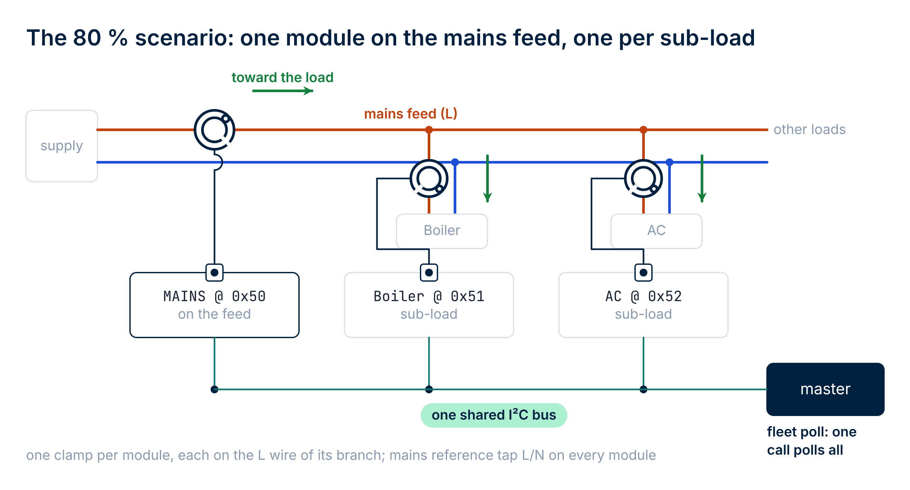
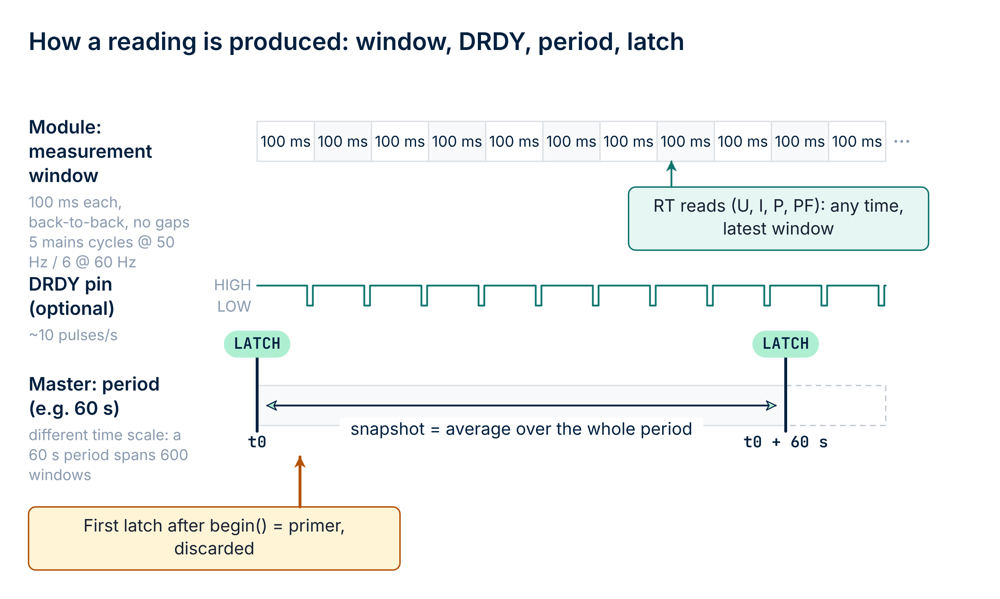

# 01 · Overview

## What rbAmp is

**rbAmp** is a compact hardware module for precision measurement of AC
mains parameters over the I²C interface. It is built around a
microcontroller with an integrated isolated analog
front-end and factory calibration stored in flash.

## The library's main purpose — monitoring multiple loads

`components/rbamp` is designed **to work with a group of modules**
on a single I²C bus at once, rather than to control a single
device. The canonical scenario is a **main module at the mains
inlet plus N modules on individual loads**, all on one bus, driven
by one ESP32. The library provides a **fleet-handle**: a single
object through which you scan the bus, poll every module in one
call, obtain the total consumed power and the "inlet − Σ(loads)"
balance, catch per-module errors, and — when needed — synchronize
period snapshots with a broadcast command.

**Multi-channel** modules are also supported. On current hardware
**I2** (2 current channels) and **I3** (3 current channels) are
available — each channel with its own CT sensor model. This is
typical for a sub-panel where a single installation point monitors
several feeders: one module gives a **per-channel current
breakdown** without a separate module on each.

> **Important architectural detail.** Power and Wh need a UI variant; a
> "mains minus sum of loads" balance needs a UI module on every load.
> The I-variants (`I1`/`I2`/`I3`)
> measure **current only** — they have no voltage, active power, or
> PF. Active energy (Wh) and power are computed **only on the
> UI-variants** (which have a voltage front-end). In the canonical
> deployment the "mains-meter" role (total energy) is filled by a
> single **UI1** at the mains inlet, while the sub-meter role
> (per-load current detail) is filled by **I2**/**I3** modules.

Working with a **single** module is the minimal case of this same
library: `rbamp_handle_t` is the building-block that the fleet is
built on top of. If you have one module on the bus, you use that
same handle directly — no fleet-API needed.

## The 80% scenario — mains + N sub-loads

- 1 module at the inlet (mains) — total consumption and grid quality.
- N modules on individual loads — per-channel accounting.
- A single fleet call `rbamp_fleet_poll_all()` polls everything; the
  balance `mains − Σ(sub_loads)` reveals the "rest" (background
  consumption, unaccounted loads, leakage).
- One shared master timestamp → correct Wh accounting with no
  inter-module drift (see [02_tiers.md](02_tiers.md) and the section
  on the master wall-clock in [09_api_reference.md](09_api_reference.md)).

For details, see chapter **06 · Examples**, scenario 1
("Mains + N sub-loads — the 80% canon"). For the API, see chapter
**09 · API Reference**, the "Fleet manager" section.

## What rbAmp measures

| Quantity | Type | Range |
|---|---|---|
| RMS voltage U_rms | float, V | 0…300 V |
| Peak voltage U_peak | float, V | 0…450 V |
| RMS current I_rms | float, A | depends on the selected sensor — see [03_sensor_selection.md](03_sensor_selection.md) |
| Peak current I_peak | float, A | depends on the selected sensor |
| Active power P (signed in RT) | float, W | depends on the selected sensor |
| Power factor PF | float | −1…+1 |
| Mains frequency | uint8, Hz | 50 / 60 Hz (detected) |
| P averaged over a period | float, W | same as P |

> **The RT value of active power `P` is always signed on any
> module line** (negative = export to the grid). The behavior of the
> period-averaged value (`avg_p[ch]` in `rbamp_period_snapshot_t`)
> **depends on the module line** — see the "Module lines" section
> below and [02_tiers.md](02_tiers.md).

## Wiring

The module connects to the master with four wires on the LV side. The
mains side (L/N voltage input and the CT clamp) is galvanically isolated
from it; see [04 · Wiring](04_hardware.md), "Mains and CT connection"
(mains voltage can kill — read the warning there first).

| Wire | Purpose |
|---|---|
| `VCC` | **+5 V (4.5..5.5 V)**, ~15 mA, peak ~25 mA. On-board regulator and filtering |
| `GND` | common with the master (**required**) |
| `SDA`, `SCL` | I²C, **3.3 V logic, 5 V-tolerant**. Built-in 4.7 kΩ pull-ups to 3.3 V |
| `DRDY` | optional, open-drain LOW ~10 µs every ~100 ms |

The default address is `0x50` (7-bit, settable range `0x08..0x77`),
the recommended speed is 50 kHz on ESP32 (see the section on the
retry+sanity discipline below). Cold start until the first valid
measurement is ~250 ms.

The full rules (bus length, pull-up recommendations on a
multi-module bus, wiring diagrams for the various ESP32 targets) are
in chapter [04 · Wiring](04_hardware.md).

## Module lines (quick cheat sheet)

**BASIC** and **STANDARD (STD)** modules are shipping; PRO is not
implemented in the component. BASIC follows the logic of a classic
mechanical meter — one-way (consumption-only) accounting; STD keeps
signed energy counters:

| Tier | RT power `P` | Per-period accumulator `avg_p[ch]` | Component Wh counter |
|---|---|---|---|
| **BASIC** | signed (negative = export to the grid, visible in real time) | each **100 ms window** of average P is clamped to `max(P, 0)` before being added to the period accumulator | **monotonic** — consumption-only accounting |
| **STANDARD (STD)** | signed; also reactive and apparent power | latch banks, or counter differences — export is kept (import and export counted separately) | **signed** net value (negative = net export) |
| **PRO** | not implemented | not implemented | not implemented |

For details, see chapter [02 · Module lines](02_tiers.md). At the
component level the same `rbamp_handle_t` handle is used regardless
of tier — `rbamp_begin()` detects the module line (`rbamp_line()`); the
differences show up in the values the module returns and in the extra
`rbamp_std_*` calls an STD module offers.

> **Bidirectional accounting on BASIC**: `rbamp_energy_wh(dev, ch)` on
> the BASIC tier gives consumption only. If you need to account for
> export separately, sample the RT power `rbamp_read_power(dev, 0, &p)`
> at ~10 Hz and split the positive and negative samples into two
> accumulator variables yourself. See the example in
> [06_examples.md](06_examples.md) (Scenario 9, "Bidirectional metering on the master side").

## What this component does

Its main job is to hide the protocol exchange and relieve the user
application of the routine of dealing with registers, byte order,
and post-command settle times. Additionally, the component
**computes energy (Wh)** — the module returns only the
period-averaged power, and the integration is done by the master via
`esp_timer_get_time()`.

The component also takes care of the period accounting: it latches,
waits for the module to settle, checks that the snapshot is valid, and
integrates Wh against the master clock (`rbamp_read_period_snapshot()` and
`rbamp_energy_wh()`, see [05 · Quickstart](05_quickstart.md) Step 5). The
register-level comparison ("without the component"), the architecture
diagram, the interaction diagrams and the mapping table are in
[09 · API Reference](09_api_reference.md), appendix "Under the hood".

## Logging and Kconfig

Unlike the Arduino library, where the log stream is configured at
runtime (`setLogStream(&Serial)`), here the standard ESP-IDF pattern
is used: the component logs under the `"rbamp"` tag via `esp_log`.
**The log level is compiled in** via the Kconfig choice
`CONFIG_RBAMP_LOG_LEVEL_*` (NONE / ERROR / WARN / INFO / DEBUG,
INFO by default). At `NONE` the log strings are removed from the
binary entirely.

The runtime filter works too (via `esp_log_level_set("rbamp", ...)`),
but it is capped from above by the compile-time level.

Six `CONFIG_RBAMP_*` symbols are available in `idf.py menuconfig` →
**Component config → rbAmp client**:

| Symbol | Purpose | Default |
|---|---|---|
| `CONFIG_RBAMP_DEFAULT_I2C_FREQ_HZ` | SCL frequency for the shared bus | 50000 (50 kHz) |
| `CONFIG_RBAMP_I2C_TIMEOUT_MS` | transmit/receive timeout | 100 ms |
| `CONFIG_RBAMP_NACK_RETRY_ATTEMPTS` | retry attempts per single-byte read | 3 |
| `CONFIG_RBAMP_NACK_RETRY_GAP_MS` | gap between retry attempts | 5 ms |
| `CONFIG_RBAMP_DISABLE_ENERGY` | remove the Wh accumulator from the build | `n` |
| `CONFIG_RBAMP_LOG_LEVEL_*` | compile-time level of log strings | INFO |

For more detail, see [09 · API Reference](09_api_reference.md), the
"Compile-time configuration" section.

## What's next

- [02 · Module lines](02_tiers.md) — which tier for which task
- [04 · Wiring](04_hardware.md) — pull-ups, bus length, ESP32-family pin-out
- [05 · Quickstart](05_quickstart.md) — your first working project
- [06 · Examples](06_examples.md) — walkthroughs of ready-made IDF projects
- [09 · API Reference](09_api_reference.md) — every public function
- [10 · Troubleshooting](10_troubleshooting.md) — when something doesn't work

