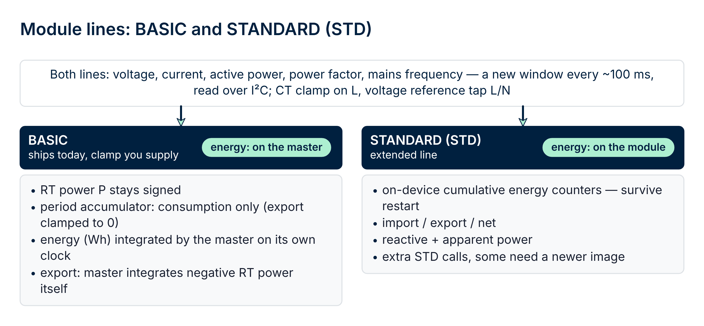
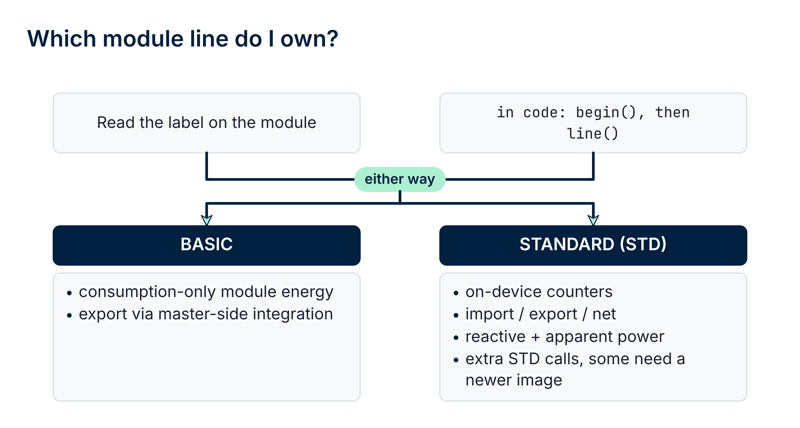

# 02 · Module Lines

## What a module line is

**rbAmp** modules come in module lines: **BASIC** and **STANDARD (STD)**
(a **PRO** line is not implemented in this component). A module line is a
complete bundle of **hardware revision and firmware**, not a software
flag. Moving between lines requires a physical SKU change, not a
firmware update.



From the component and user-code perspective: **one handle and one
`rbamp_*` API serve both shipping module lines**. `rbamp_begin()` detects
whether the module behind the handle is a BASIC or an STD module
(`rbamp_line()`), and the calls that exist on only one of them return
`ESP_ERR_NOT_SUPPORTED` on the other. The differences show up in what
values the module returns, in the extra quantities the STD module
measures, and in how the firmware treats the data (in particular —
export to the grid).

## Current status

**BASIC and STANDARD (STD) modules are shipping** and are both supported
by this component (version 1.7.2). The **PRO** line is not implemented in
the component.

| Module line | Status in this component |
|---|---|
| **BASIC** | ✅ shipping — `RBAMP_LINE_BASIC` |
| **STANDARD (STD)** | ✅ shipping — `RBAMP_LINE_STD` |
| **PRO** | not implemented |

## BASIC — entry-level consumption-metering module line

### Hardware

A cost-optimized analog path suited to typical household loads.
The module includes an isolated analog front-end, an on-board power
regulator, and factory calibration stored in flash.

### Firmware behavior

The logic of a classic mechanical disc meter — **counting only goes
forward, export to the grid is not subtracted**.

The three "layers" of active-power values behave differently:

| Signal | Meaning | Behavior on BASIC |
|---|---|---|
| `rbamp_read_power(dev, ch, &p)` | instantaneous RT power, updated every ~100 ms | **signed** — a negative value is visible in real time (export) |
| `snap.avg_p[ch]` (inside `rbamp_read_period_snapshot`) | average power over the period | each 100 ms average-P window is **clamped** to `max(P, 0)` before being added to the period accumulator |
| `rbamp_energy_wh(dev, ch)` | Wh accumulated by the component | **monotonic** — consumption only, export is not counted |

In other words: the user **sees** export in the RT reading, but the
component's Wh counter on BASIC does not include it.

### Typical applications

- Households without their own generation (no solar panels,
  wind turbines, battery systems)
- Submeters for purely consuming loads (water heaters, motors,
  household appliances)
- Building consumption monitoring where bidirectional metering is
  not required

### Bidirectional metering on BASIC (master-side)


If you need to track export to the grid separately on a BASIC module,
**do it on the master side**. The RT power
`rbamp_read_power(dev, 0, &p)` is signed, so:

```c
#include "esp_timer.h"
#include "freertos/FreeRTOS.h"
#include "freertos/task.h"

static double consume_wh = 0.0;
static double export_wh  = 0.0;

void bidirectional_loop(rbamp_handle_t dev) {
    int64_t t_prev_us = esp_timer_get_time();

    while (1) {
        /* Sample RT power at 10 Hz. Slower polling loses resolution
         * on sharp load transitions; faster adds little for typical
         * mixed loads with an inverter. */
        vTaskDelay(pdMS_TO_TICKS(100));

        int64_t t_now_us = esp_timer_get_time();
        double  dt_s     = (double)(t_now_us - t_prev_us) / 1e6;
        t_prev_us = t_now_us;

        float p;
        if (rbamp_read_power(dev, 0, &p) != ESP_OK) continue;

        double dwh = (double)p * dt_s / 3600.0;
        if (p >= 0.0f) consume_wh += dwh;
        else           export_wh  += -dwh;
    }
}
```

A complete working example of the pattern is in [06_examples.md](06_examples.md),
the "Master-side bidirectional metering" scenario.

## STANDARD (STD) — the extended-measurement module line

STD modules are supported by the same `rbamp_*` API; `rbamp_begin()`
detects them. On top of what BASIC offers, an STD module provides:

- **Signed energy.** Import and export are separate magnitudes, and the
  module keeps persisted life-time counters (Wh / varh, plus finer
  resolutions on newer firmware). Export is **not clamped away**: a
  period's energy is the difference of two counter readings
  (`rbamp_std_read_energy()` / `rbamp_std_energy_delta()`), and
  `rbamp_energy_wh()` carries a signed net value on such modules.
- **More quantities:** reactive power and apparent power per channel
  (`rbamp_read_reactive_power()`, `rbamp_read_apparent_power()`,
  `rbamp_std_read_channel()`), per-phase and grand totals, and — once
  harmonics extraction is switched on — THD and displacement power
  factor. Three-phase modules also report the voltage phase angles and
  the phase sequence.
- **Period mechanisms:** latch banks (eight independent, master-timed
  periods) on modules that have them, or counter differences on modules
  that keep energy on the device. The mechanism is chosen at
  `rbamp_begin()` (`rbamp_std_info_t.period_source`).
- **CT model is a label only.** On an STD module the CT model is a label only and sets no gain.
- **Module clock, on-device history and an event log, health and
  diagnostics, firmware update over I²C, a device certificate and
  attestation.**

All of this is documented in [09 · API Reference](09_api_reference.md),
chapter "STD line". A working example is
[`examples/std_meter/`](https://github.com/rb-amp/rbamp-esp-idf/tree/main/examples/std_meter/)
(see [06 · Examples](06_examples.md), Scenario 18).

### Behaviour that differs from BASIC

| Topic | BASIC | STD |
|---|---|---|
| Export in `rbamp_energy_wh()` | not counted (monotonic, consumption only) | signed — net of import and export |
| Reactive / apparent power, THD | not available — on BASIC, reactive power is not exposed by this library (`ESP_ERR_NOT_SUPPORTED`) | available |
| Period source | latch of the period accumulator | latch banks, or counter differences |
| Module clock | none | set it with `rbamp_std_set_time()` after every module reset |
| `rbamp_factory_reset()` | supported | `ESP_ERR_NOT_SUPPORTED` |
| Digest (`rbamp_read_digest()`) | supported on firmware with the capability | `ESP_ERR_NOT_SUPPORTED` |
| Period calls on a module with neither latch banks nor counters | — | `ESP_ERR_NOT_SUPPORTED` |

### Typical applications

- Homes with rooftop solar generation, wind turbines or batteries
- Regenerative loads, V2G electric-vehicle charging
- Installations that need reactive power, power factor and harmonics
  in addition to active power

## PRO — not implemented

The PRO line is **not implemented** in this component: there is no
PRO-specific API in version 1.7.2.

## How to detect the module line at runtime


The product line is detected for you by `rbamp_begin()`:

```c
/* BASIC or STD — available after rbamp_begin() */
rbamp_line_t line = rbamp_line(dev);    /* RBAMP_LINE_BASIC / RBAMP_LINE_STD */

/* Full SKU — cached by rbamp_begin(), no bus traffic */
rbamp_variant_t variant = rbamp_variant(dev);   /* UI1 / UI2 / ... / I3 / UI5 / UI7 */

/* Voltage-sensing presence (UI* variants vs I*-only) */
bool voltage_hw = rbamp_has_voltage_hw(dev);

/* Number of current channels (1 / 2 / 3 / 5 / 7) */
uint8_t channels = rbamp_channels(dev);

/* Firmware: BASIC — REG_VERSION byte; STD — register-map version */
uint8_t fw = rbamp_firmware_version(dev);

/* STD only: identity, capabilities and the period mechanism */
rbamp_std_info_t info;
if (rbamp_line(dev) == RBAMP_LINE_STD && rbamp_std_info(dev, &info) == ESP_OK) {
    /* info.capabilities, info.n_voltage, info.n_current, info.period_source */
}
```

> **Note**: `rbamp_line()` tells BASIC from STD; the line above STD (PRO)
> is not implemented. Use the SKU label on the module enclosure as the
> source of truth for the exact product.

## Where line-dependent details are marked in the docs

In the component text and the canonical documentation, line-dependent
features are marked explicitly, for example:

> **STD only** — this function is not available on the BASIC module
> (`ESP_ERR_NOT_SUPPORTED`).

Or, conversely, BASIC-specific behavior:

> **BASIC**: the `rbamp_energy_wh(dev, ch)` counter is monotonic —
> export to the grid is not counted. For bidirectional metering, see
> the "Master-side bidirectional metering" scenario in
> [06_examples.md](06_examples.md), or use an STD module.

## What's next

- [03 · Current-sensor selection](03_sensor_selection.md) — which SCT-013
  for which job
- [04 · Wiring](04_hardware.md) — hardware nuances
- [06 · Examples](06_examples.md) — scenarios for BASIC, including
  master-side bidirectional metering
- [09 · API reference](09_api_reference.md) — the full public API

