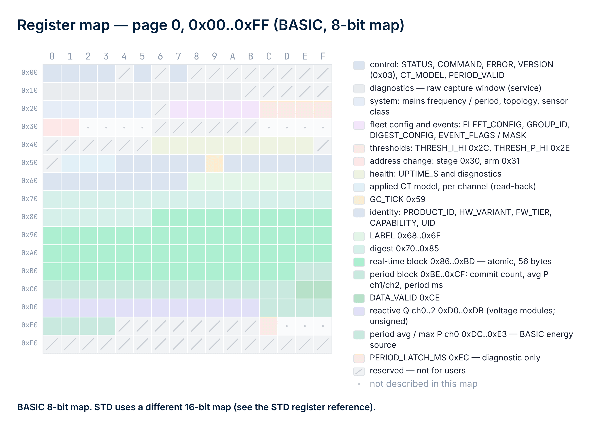
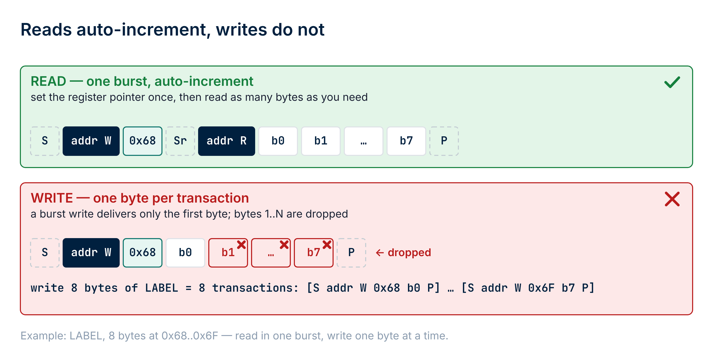
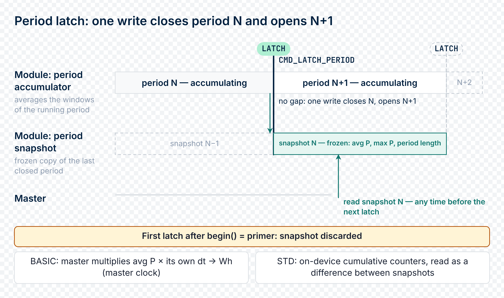
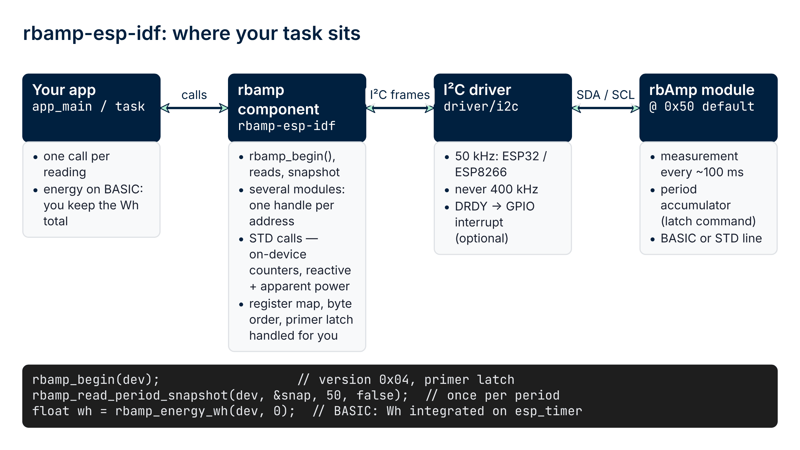
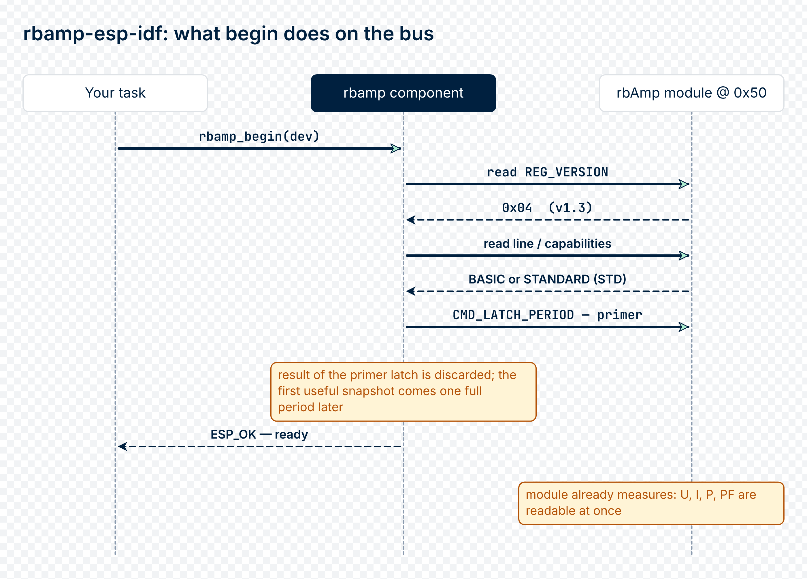
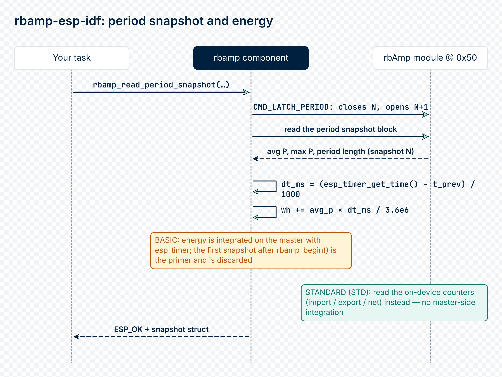

# 09 · API Reference

The complete public API of the `rbamp` component for ESP-IDF.
The source is the header file [`include/rbamp.h`](https://github.com/rb-amp/rbamp-esp-idf/blob/main/include/rbamp.h)
with Doxygen comments; the multi-module manager is in
[`include/rbamp_fleet.h`](https://github.com/rb-amp/rbamp-esp-idf/blob/main/include/rbamp_fleet.h)
and the Wh accumulator type in
[`include/rbamp_energy.h`](https://github.com/rb-amp/rbamp-esp-idf/blob/main/include/rbamp_energy.h).

This chapter is a reference: signatures, return values, side
effects, edge cases. For working examples go to
[06 · Examples](06_examples.md); for a quick start, see
[05 · Quickstart](05_quickstart.md).

## Header file

`#include "rbamp.h"` — the main public header. It transitively
pulls in `esp_err.h` for `esp_err_t` and `driver/i2c_master.h` for
the `i2c_master_bus_handle_t` type. No additional includes are
required.

The API is wrapped in an `extern "C"` block — compatible with both
C and C++ callers.

## General idioms

The API follows standard ESP-IDF patterns:

- **Opaque handle**: `rbamp_handle_t` — a typedef for
  `struct rbamp_obj_t *`; the user does not reach into its internals.
  Created via `rbamp_new()`, freed via `rbamp_del()`.
- **`esp_err_t` returns** — `ESP_OK` on success, one of the
  `ESP_ERR_*` codes on failure. Use `ESP_ERROR_CHECK()` for
  abort-on-error handling, or check manually.
- **Output-via-pointer**: functions that return a value take a
  pointer to a buffer as the last parameter. This lets a single call
  return both an `esp_err_t` and a value.
- **Human-readable error strings**: `rbamp_err_to_str(err)` returns
  a pointer to a static string. It never returns `NULL`.
- **One handle, two module lines**: the same handle and the same scalar
  API serve the BASIC and the STD module line; `rbamp_begin()` detects
  the line and routes every call. Functions that exist on only one line
  return `ESP_ERR_NOT_SUPPORTED` on the other (see
  [`rbamp_line_t`](#rbamp_line_t) and [STD line](#std-line)).
- **Commands are not retried.** A command write (latch, reset, save, ...)
  is never repeated after a transport error — a retry could deliver the
  opcode twice. Data-register reads and writes keep the NACK retry.
- **Error mapping** used across the API: `ESP_ERR_NOT_SUPPORTED` — the
  function or feature does not exist on this line / firmware / module;
  `ESP_ERR_NOT_FOUND` — the module or record is not present (nothing
  acknowledges, no such history record, no certificate);
  `ESP_ERR_INVALID_STATE` — a precondition or call sequence is wrong, or
  a paired-sensor module is protected (see
  [Error codes](#error-codes)).

## Types

### `rbamp_handle_t`

```c
typedef struct rbamp_obj_t *rbamp_handle_t;
```

An opaque handle to a slave device. The user has no access to its
fields. Created via `rbamp_new()`, freed via `rbamp_del()`.

### `rbamp_topology_t`

```c
typedef enum {
    RBAMP_TOPOLOGY_SINGLE      = 1,  /* 1 current channel (UI1 / I1) */
    RBAMP_TOPOLOGY_SPLIT_PHASE = 2,  /* 2 current channels (UI2 / I2) */
    RBAMP_TOPOLOGY_THREE_PHASE = 3,  /* 3 current channels (UI3 / I3) */
    RBAMP_TOPOLOGY_FIVE_CH     = 5,  /* 5 current channels (UI5)      */
    RBAMP_TOPOLOGY_SEVEN_CH    = 7,  /* 7 current channels (UI7)      */
} rbamp_topology_t;
```

The value is the **channel count**. `rbamp_begin()` adopts it from the
module's variant; `rbamp_new_with_topology()` pins it instead. The
enum is intentionally non-contiguous (there is no 4 or 6): the
larger SKUs step 3 → 5 → 7.

Two constants size your arrays:

| Macro | Value | Meaning |
|---|:---:|---|
| `RBAMP_MAX_CHANNELS` | 7 | The largest channel count any SKU exposes. Size channel arrays with it. |
| `RBAMP_SNAPSHOT_CHANNELS` | 3 | Channels carried by `rbamp_snapshot_t` (ch0–2). Channels 3+ are read with `rbamp_read_channel()` / `rbamp_read_all_channels()`. |

### `rbamp_sensor_class_t`

```c
typedef enum {
    RBAMP_SENSOR_UNSET      = 0,  /* Factory default */
    RBAMP_SENSOR_SCT013     = 1,  /* SCT-013 fitted by the user */
    RBAMP_SENSOR_WIRED_CT   = 2,  /* Wired CT shipped with the module, calibrated as a pair */
    RBAMP_SENSOR_BUILTIN_CT = 3,  /* Built-in CT, calibrated as a pair */
} rbamp_sensor_class_t;
```

Class 1 is a module the user fits with an SCT-013 of their choice —
the CT model selects the sensor type. Classes 2 and 3 are modules
that ship together with their sensor and are calibrated with it.
The library does **not** rewrite the class or the model of such a
module: `rbamp_set_sensor_class()` and `rbamp_set_ct_model_ch()`
return `ESP_ERR_INVALID_STATE`. A service re-pairing goes through
`rbamp_set_ct_model_ch_force()`.

### `rbamp_variant_t`

The hardware build variant, returned by `rbamp_variant()` and
`rbamp_read_variant()`:

| Value | Enum | Channels | Voltage / power |
|:---:|---|:---:|---|
| 0 | `RBAMP_VARIANT_UNKNOWN` | — | not read yet / not published |
| 1 | `RBAMP_VARIANT_UI1` | 1 | yes |
| 2 | `RBAMP_VARIANT_UI2` | 2 | yes |
| 3 | `RBAMP_VARIANT_UI3` | 3 | yes |
| 4 | `RBAMP_VARIANT_I1` | 1 | no |
| 5 | `RBAMP_VARIANT_I2` | 2 | no |
| 6 | `RBAMP_VARIANT_I3` | 3 | no |
| 7 | `RBAMP_VARIANT_UI5` | 5 | yes |
| 8 | `RBAMP_VARIANT_UI7` | 7 | yes |

### `rbamp_line_t`

```c
typedef enum {
    RBAMP_LINE_BASIC = 0,  /* default until rbamp_begin() has run */
    RBAMP_LINE_STD   = 1,
} rbamp_line_t;
```

One handle type and one API serve both module lines.
`rbamp_begin()` discovers the line from the module's identity block
and every later call is routed internally. Query it with
`rbamp_line(dev)`. Calls that have no counterpart on the detected
line return `ESP_ERR_NOT_SUPPORTED` — never a wrong-register read.
What only the STD line offers (reactive / apparent power, THD, signed
energy counters, latch banks, history) is collected in
[STD line](#std-line).

### `rbamp_snapshot_t`

Returned by `rbamp_read_all()`. All fields are in SI units. Unused
channels (beyond `channels`) are zero-filled.

```c
typedef struct {
    float voltage;          /* V — RMS voltage */
    float voltage_peak;     /* V — peak voltage */
    float current[3];       /* A — RMS current, ch0–2 */
    float current_peak[3];  /* A — peak current, ch0–2 */
    float power[3];         /* W — active power, ch0–2 (signed) */
    float power_factor[3];  /* dimensionless, −1..+1 */
    float frequency;        /* Hz — mains frequency */
    rbamp_topology_t topology;
    uint8_t channels;       /* the module's channel count: 1, 2, 3, 5 or 7 */
    bool has_voltage_hw;    /* true if a voltage sensor is present */
    uint8_t implausible;    /* bitmask of RBAMP_FIELD_* classes set to NaN; 0 = all OK */
} rbamp_snapshot_t;
```

The arrays hold **channels 0–2 only**. On a UI5/UI7 `channels`
reports the full count (5 or 7); read channels 3+ with
`rbamp_read_channel()` / `rbamp_read_all_channels()`.

**Implausible fields.** A single out-of-bound field does not fail the
whole snapshot: a field that trips its per-quantity sanity bound is
set to `NaN` and its class bit is raised in `implausible`, while the
rest stays usable and `rbamp_read_all()` still returns `ESP_OK`.
Check `implausible` (or `isnan()` per field) before consuming a value.

| Bit | Meaning |
|---|---|
| `RBAMP_FIELD_VOLTAGE` | voltage / voltage_peak rejected |
| `RBAMP_FIELD_CURRENT` | a current / current_peak rejected |
| `RBAMP_FIELD_POWER` | a power rejected |
| `RBAMP_FIELD_PF` | a power_factor rejected |
| `RBAMP_FIELD_FREQUENCY` | frequency rejected |

The bounds are `RBAMP_SANITY_LIMIT_V` / `_I` / `_P` / `_PF`
(500 V, 150 A, 30 000 W, 1.5). Only a genuine transport failure
makes `rbamp_read_all()` return non-OK.

### `rbamp_channel_reading_t`

Returned by `rbamp_read_channel()` / `rbamp_read_all_channels()` — one
channel, any index.

```c
typedef struct {
    float   i_rms;        /* A */
    float   i_peak;       /* A */
    float   p_real;       /* W (signed) */
    float   pf;           /* −1..+1 */
    uint8_t implausible;  /* RBAMP_FIELD_* bits; the flagged field is NaN */
} rbamp_channel_reading_t;
```

### `rbamp_period_snapshot_t`

Returned by `rbamp_read_period_snapshot()`. The energy-accounting
primitive.

```c
typedef struct {
    float    avg_p[3];          /* W — average active power over the period, ch0–2 */
    float    max_p;             /* W — peak power on channel 0 during the period */
    uint32_t latch_ms;          /* ms — module-reported duration; DIAGNOSTIC, not for energy */
    uint32_t master_dt_ms;      /* ms — master wall-clock window since the previous consumed read (CANONICAL) */
    bool     valid;             /* the period was ready at read time */
    float    avg_p_total;       /* W — average active power summed over ALL channels (signed) */
    double   wh_net;            /* Wh — net energy of this period as the library accounted it (signed) */
    bool     module_restarted;  /* the module rebooted inside this period */
    uint32_t module_window_ms;  /* ms — the module's own length of the latched window (0 on STD) */
    uint16_t module_commit_ms;  /* ms — length of one module commit as inferred: 100 or 200 (0 on STD) */
    uint32_t module_uptime_s;   /* s — module uptime read with the snapshot (0 if not published) */
    bool     window_from_boot;  /* the window started at the module's boot */
    bool     window_long;       /* module_window_ms exceeds 6 h */
} rbamp_period_snapshot_t;
```

| Field | Notes |
|---|---|
| `avg_p[3]` | Channels 0–2 only. On a UI5/UI7 the module latches average power for **all** channels atomically; read channels 3+ with `rbamp_read_period_avg_power()` and their Wh with `rbamp_energy_wh()` (the accumulator integrates every channel). |
| `max_p` | A global peak, taken on channel 0. |
| `latch_ms` | Diagnostic only; it may read short under load. The energy-integration window is `master_dt_ms` or `module_window_ms`. |
| `master_dt_ms` | The window the library integrates energy over: the master's own `esp_timer` time between two consecutive **consumed** reads. |
| `avg_p_total`, `wh_net` | The period summed over all channels. `wh_net` is average power × `master_dt_ms`, or — on modules that keep energy on the device — the module's own counter difference. |
| `module_window_ms`, `module_commit_ms` | The module's measure of the latched window: commits counted on the module's measurement clock, **100 ms each on current firmware and 200 ms on firmware older than v1.2** — the library infers which from the same snapshot. Normally cross-checks `master_dt_ms`. Both are 0 on the STD line. |
| `module_restarted` | The module rebooted inside the period. Its RAM settings (clock, event mask, thresholds, digest fields) need re-applying — the library re-applies those it owns. On a BASIC module it is set on the first snapshot after `rbamp_begin_resume()` when the window started at the module's boot. |
| `module_uptime_s`, `window_from_boot` | `window_from_boot` is true when the latched window started at the module's boot (a restart, or the first latch since boot). Always false when the firmware does not publish uptime (`module_uptime_s` = 0). |
| `window_long` | The window exceeds 6 h: the module's average loses precision over very long windows — latch more often. |

> ⚠ **`latch_ms` is diagnostic, not for energy.** It is the module's own
> measure of the period and it may read short under load. **Do not use
> it for energy integration.** The canonical dt for energy is
> `master_dt_ms` (or your own `esp_timer_get_time()` delta), or
> `module_window_ms` for the first snapshot after
> `rbamp_begin_resume()`.

### Event bits — `rbamp_event_bit_t`

Bits of the sticky, write-1-to-clear `EVENT_FLAGS` byte (see
[Events](#events-and-the-alarm-line)):

| Enum | Meaning |
|---|---|
| `RBAMP_EVENT_PERIOD_READY` | A period snapshot latched |
| `RBAMP_EVENT_THRESH_I` | Current threshold crossed |
| `RBAMP_EVENT_THRESH_P` | Power threshold crossed |
| `RBAMP_EVENT_ERROR` | Durable error indicator (see [Error model](#error-model-v13)) |
| `RBAMP_EVENT_CONFIG_CHANGED` | Persisted configuration changed |
| `RBAMP_EVENT_RESET_OCCURRED` | The module reset since the last clear |
| `RBAMP_EVENT_NVM_FAULT` | STD only: energy-store fault |

### `rbamp_drdy_event_t`

Filled by `rbamp_wait_data_ready()` / `rbamp_read_all_ready()`:

```c
typedef struct {
    bool     fresh;        /* a new snapshot of THIS module is available (true on ESP_OK) */
    bool     by_edge;      /* woken by the DRDY edge (false = found by polling) */
    uint16_t seq;          /* snapshot sequence now */
    uint16_t missed;       /* snapshots published since the previous call that were not read */
    bool     alarm;        /* the line was held LOW: an unmasked event is pending on this module */
    uint8_t  event_flags;  /* EVENT_FLAGS consumed on an alarm (RBAMP_EVENT_*), else 0 */
    uint32_t latency_us;   /* edge to return, µs (0 when polling) */
} rbamp_drdy_event_t;
```

### Digest types

```c
typedef enum {
    RBAMP_DIGEST_I  = ..., /* RMS current per channel */
    RBAMP_DIGEST_U  = ..., /* RMS voltage (modules with voltage sensing only) */
    RBAMP_DIGEST_P  = ..., /* real power per channel, whole watts, signed */
    RBAMP_DIGEST_PF = ..., /* |power factor| per channel */
} rbamp_digest_field_t;

typedef struct {
    uint8_t status;     /* STATUS mirror at the moment of the publish */
    uint8_t seq;        /* window sequence (one step per published window, wraps 255→0) */
    uint8_t n_ch;       /* channels in the digest: min(module channels, 3) */
    uint8_t fields;     /* which rbamp_digest_field_t bits were read */
    float   i_a[3];     /* A; 0 when the field is off */
    float   u_v;        /* V; 0 when off or no voltage sensing */
    int16_t p_w[3];     /* W, signed, truncated toward 0 (|P| < 1 W reads 0); 0 when off */
    float   pf[3];      /* |PF| 0..1; 0 when off */
} rbamp_digest_t;
```

### SCT-013 correction types

```c
typedef enum {
    RBAMP_SCT_NONE,           /* no correction (scale 1) */
    RBAMP_SCT_CORRECTED,      /* scale applied to this channel */
    RBAMP_SCT_UNCALIBRATED,   /* after a reset the module applies the raw preset; scale 1, warning logged */
    RBAMP_SCT_GAIN_UNEXPECTED,/* applied gain is not that of a 30 A-calibrated module; scale 1, warning logged */
    RBAMP_SCT_UNKNOWN_MODEL,  /* model code without a known preset; scale 1, warning logged */
    RBAMP_SCT_PENDING,        /* not evaluated yet (before rbamp_begin); scale 1 */
} rbamp_sct_status_t;

typedef struct {
    rbamp_sct_status_t status;
    uint8_t model;        /* CT model the module reports for the channel */
    float   scale;        /* factor applied to current, power, energy and digest (1.0 unless CORRECTED) */
    float   gain_applied; /* gain the module applies (0 when not read) */
} rbamp_sct_correction_t;
```

`RBAMP_SCT_NONE` is reported on the STD line, for sensor class 2/3,
with no model bound, with model 3 (the factory 30 A sensor), on a
module that corrects itself (see
[SCT-013 rating correction](#sct-013-rating-correction)) and when
`CONFIG_RBAMP_SCT_RATING_CORRECTION` is off.

STD-line types (`rbamp_std_info_t`, `rbamp_std_channel_t`, ...) are
described together with their functions in [STD line](#std-line).


## Lifecycle

### `rbamp_new`

```c
esp_err_t rbamp_new(i2c_master_bus_handle_t bus,
                    uint8_t addr,
                    rbamp_handle_t *out);
```

Creates an opaque handle for a slave device. Internally it creates
an `i2c_master_dev_handle_t` via `i2c_master_bus_add_device()`.

The **channel count and voltage presence are taken from the module in
`rbamp_begin()`**: a UI1 reports 1 channel, a UI3 reports 3, a UI7
reports 7, and so on, so `rbamp_channels(dev)` is right after begin and
the per-channel API (`rbamp_set_ct_model_ch`, ...) guards against
channels the module does not have. Only when the module does not publish
its variant (firmware older than v1.3) does the handle fall back to
`RBAMP_TOPOLOGY_THREE_PHASE`; over-detection is harmless there — unused
channels read `0.0 A`. Use `rbamp_new_with_topology()` to pin a count
regardless of what the module says.

| Parameter | Description |
|---|---|
| `bus` | I²C bus handle created via `i2c_new_master_bus()`. |
| `addr` | 7-bit slave address. Range 0x08..0x77, default 0x50. |
| `out` | Where to write the new handle. |

**Returns**: `ESP_OK` on success; `ESP_ERR_NO_MEM` if memory could
not be allocated; `ESP_ERR_INVALID_ARG` if `bus == NULL` or
`out == NULL` or `addr` is out of range; the `esp_err_t` from
`i2c_master_bus_add_device()` on a bus-driver error.

### `rbamp_new_with_topology`

```c
esp_err_t rbamp_new_with_topology(i2c_master_bus_handle_t bus,
                                  uint8_t addr,
                                  rbamp_topology_t topology,
                                  rbamp_handle_t *out);
```

Same as `rbamp_new`, but with an explicit topology. It **pins the
channel count**: `rbamp_begin()` keeps it even when the module reports a
different one (a warning is logged). The variant and voltage presence
still follow the module. Needed only for firmware older than v1.3 that
does not publish its variant, or to deliberately expose fewer or more
channels than the module has.

### `rbamp_del`

```c
void rbamp_del(rbamp_handle_t dev);
```

Frees the handle and removes the associated `i2c_master_dev_handle_t`
from the bus. Safe to call with `NULL` — it is a no-op.

### `rbamp_begin`

```c
esp_err_t rbamp_begin(rbamp_handle_t dev);
```

Probes the device, detects the module line, adopts the channel count
and variant, and primes LATCH.

Sequence:

1. Read `REG_VERSION` (0x03). If the device did not ACK — `ESP_FAIL`.
   If it returned `0x00` / `0xFF` — `ESP_ERR_INVALID_RESPONSE`.
2. Detect the **product line** (BASIC / STD) from the module's
   identity block and cache it (`rbamp_line()`). On the STD line the
   identity is cached too (`rbamp_std_info()`) and the period mechanism is
   chosen.
3. Adopt the channel count, variant and voltage presence from the
   module (unless a topology was pinned by `rbamp_new_with_topology`).
4. Evaluate the SCT-013 rating correction (see
   [SCT-013 rating correction](#sct-013-rating-correction)).
5. Write `CMD_LATCH_PERIOD` as a primer + wait 50 ms. The first
   snapshot after power-on is discarded. (`rbamp_begin_resume()` skips
   this step.)
6. Save `esp_timer_get_time()` for subsequent energy integration.

Idempotent but **not free**: each call issues one primer LATCH.

**Returns**: `ESP_OK` on success; the error codes above otherwise.

### `rbamp_begin_resume`

```c
esp_err_t rbamp_begin_resume(rbamp_handle_t dev);
```

`rbamp_begin()` **without the primer latch** — it keeps the window
the module accumulated while the master was away. A BASIC module keeps
averaging until the next latch, so after a master reboot or outage the
module still holds the whole window since the last consumed snapshot;
`rbamp_begin()` would latch and discard it, this call does not.

The first consumed `rbamp_read_period_snapshot()` after it integrates
over the module's own window (`module_window_ms`):
`wh_net = avg_p_total × module_window_ms`, `master_dt_ms` is set equal
to `module_window_ms` and `module_restarted = window_from_boot`. Every
later snapshot uses the master clock as usual. A stale first read
(period not valid, empty accumulator) is dropped like any other, and
the next valid read still uses the module window.

On firmware that does not publish uptime, `window_from_boot` and
`module_restarted` stay false: the recovered window may then include a
module restart that the library cannot see. On STD modules the call is
identical to `rbamp_begin()` (their energy lives in counters on the
module).

### `rbamp_begin_event_flags`

```c
uint8_t rbamp_begin_event_flags(rbamp_handle_t dev);
```

The `EVENT_FLAGS` as `rbamp_begin()` found them (both lines; `0` if
they were not readable). `RBAMP_EVENT_RESET_OCCURRED` here means the
module had rebooted before the library met it — re-apply its RAM
settings (clock, event mask, thresholds). The library clears nothing at
begin. No bus traffic.

### `rbamp_probe`

```c
esp_err_t rbamp_probe(rbamp_handle_t dev);
```

A lightweight liveness check. A single read of `REG_VERSION` with no
side effects.

**Returns**: `ESP_OK` if the slave ACKed and reported a supported
version (not `0` and not `0xFF`); `ESP_FAIL` otherwise.

### `rbamp_wait_ready`

```c
esp_err_t rbamp_wait_ready(rbamp_handle_t dev, uint32_t timeout_ms);
```

Polls the module's ready flag until bit 0 is set. Useful after
power-on — the module may need up to 100 ms for the first RT window.

**Returns**: `ESP_OK` if the bit is seen before `timeout_ms`
expires; `ESP_ERR_TIMEOUT` otherwise.

### Handle-state getters

```c
uint8_t          rbamp_firmware_version(rbamp_handle_t dev);
rbamp_topology_t rbamp_topology         (rbamp_handle_t dev);
uint8_t          rbamp_channels         (rbamp_handle_t dev);
rbamp_variant_t  rbamp_variant          (rbamp_handle_t dev);
bool             rbamp_has_voltage_hw   (rbamp_handle_t dev);
uint8_t          rbamp_address          (rbamp_handle_t dev);
rbamp_line_t     rbamp_line             (rbamp_handle_t dev);
```

All return cached values without touching the bus.

| Function | Returns |
|---|---|
| `rbamp_firmware_version` | The `REG_VERSION` byte cached after `rbamp_begin()` — on the STD line this is the register-map version, not the firmware image version (see `rbamp_std_read_image_version`). `0` before `rbamp_begin()` or if it failed. |
| `rbamp_topology` | The channel-count enum — from the module after `rbamp_begin()`, or as pinned by `rbamp_new_with_topology()`; `THREE_PHASE` before begin / on firmware that does not publish its variant. |
| `rbamp_channels` | Number of valid current channels (1, 2, 3, 5 or 7). |
| `rbamp_variant` | The variant cached by `rbamp_begin()`; `RBAMP_VARIANT_UNKNOWN` before begin or when the module does not publish it. `rbamp_read_variant()` re-reads the register. |
| `rbamp_has_voltage_hw` | `true` if voltage sensing hardware was detected. |
| `rbamp_address` | The current 7-bit address (updates after `rbamp_commit_address_change()`). |
| `rbamp_line` | `RBAMP_LINE_BASIC` until `rbamp_begin()` has run, then the detected line. |

### `rbamp_basic_fw_name`

```c
const char *rbamp_basic_fw_name(uint8_t version);
```

A pure lookup (no bus traffic): the human firmware name for a BASIC
`REG_VERSION` byte as returned by `rbamp_firmware_version()` — for
example `0x0D` → `"1.4.21"`, `0x0C` → `"1.4.20"`, `0x0B` → `"1.4.19"`,
`0x0A` → `"1.4.18"`, `0x07` →
`"1.4.15-1.4.17"`, `0x05` → `"1.4.4-1.4.14"`, `0x04` → `"1.2-1.4.3"`,
`0x00..0x03` → `"<1.2"`. Any other byte → `NULL` (unknown, or not a
BASIC module).

## Real-time reads (RT block, 100 ms refresh)

All functions return `esp_err_t`. On `ESP_OK` the value is written
to the `out` pointer; on error `*out` is undefined. Under the hood
there is a retry+sanity discipline for resilience against the rare
link glitches in the ESP-IDF I²C stack.

### Per-channel reads

```c
esp_err_t rbamp_read_voltage      (rbamp_handle_t dev, uint8_t phase, float *out);
esp_err_t rbamp_read_voltage_peak (rbamp_handle_t dev, uint8_t phase, float *out);
esp_err_t rbamp_read_current      (rbamp_handle_t dev, uint8_t ch,    float *out);
esp_err_t rbamp_read_current_peak (rbamp_handle_t dev, uint8_t ch,    float *out);
esp_err_t rbamp_read_power        (rbamp_handle_t dev, uint8_t ch,    float *out);
esp_err_t rbamp_read_power_factor (rbamp_handle_t dev, uint8_t ch,    float *out);
esp_err_t rbamp_read_frequency    (rbamp_handle_t dev,                float *out);
```

| Function | Return value | Notes |
|---|---|---|
| `rbamp_read_voltage` | RMS voltage, V | `phase = 0` on the BASIC line |
| `rbamp_read_voltage_peak` | Peak voltage, V | Reads 0 on STD module map 0x34 and earlier — use a latch bank's `max_u` / `min_u` |
| `rbamp_read_current` | RMS current on the channel, A | `ch` < `rbamp_channels(dev)`; channels 3+ (UI5 / UI7) are routed through the channel window transparently |
| `rbamp_read_current_peak` | Peak current on the channel, A | Reads 0 on STD module map 0x34 and earlier — use a latch bank's `max_i` |
| `rbamp_read_power` | Active power, W **(signed)** | Negative = export (PV / bidirectional installs) |
| `rbamp_read_power_factor` | Power factor | Dimensionless, −1..+1 |
| `rbamp_read_frequency` | Mains frequency, Hz | 50.0 or 60.0 on a healthy grid. STD: a module value of 0 (no mains) returns `ESP_ERR_INVALID_RESPONSE` with `*out = NaN` |

If `ch` or `phase` is out of range, returns `ESP_ERR_INVALID_ARG`.

### One-shot read of the whole RT block

```c
esp_err_t rbamp_read_all(rbamp_handle_t dev, rbamp_snapshot_t *out);
```

Equivalent to sequential
`rbamp_read_voltage` + `rbamp_read_voltage_peak` +
`rbamp_read_current(0..N)` + `rbamp_read_current_peak(0..N)` +
`rbamp_read_power(0..N)` + `rbamp_read_power_factor(0..N)` +
`rbamp_read_frequency`. Unused channels (beyond
`rbamp_channels(dev)`) are zero-filled.

On a module with **more than three channels (UI5 / UI7) only
channels 0–2 are read** into the struct
(`RBAMP_SNAPSHOT_CHANNELS = 3`); channels 3+ are not touched — read them
with `rbamp_read_channel()` / `rbamp_read_all_channels()`. On the STD
line the voltage block and each channel block are read whole (one
transaction each).

A field that trips its sanity bound does **not** fail the call: it is
set to `NaN` and flagged in `snap.implausible`, and the call still
returns `ESP_OK` (see [`rbamp_snapshot_t`](#rbamp_snapshot_t)).

**Returns**: `ESP_OK` on success (check `implausible`); the first
underlying transport error otherwise — in which case the contents of
`out` are partial and must not be consumed.

### Reactive and apparent power

```c
esp_err_t rbamp_read_reactive_power(rbamp_handle_t dev, uint8_t ch, float *out);
esp_err_t rbamp_read_apparent_power(rbamp_handle_t dev, uint8_t ch, float *out);
```

Reactive power of channel `ch` in var (signed) and apparent power in
VA. These quantities exist only on the STD line; on BASIC, reactive power
is not exposed by this library, and on a BASIC handle both return
`ESP_ERR_NOT_SUPPORTED`.

### Channel access (channels 3 and above)

Channels 0–2 live in the flat RT block. On the larger SKUs (UI5 / UI7)
channels 3+ are reachable only through the module's channel window. The
library handles this transparently: `rbamp_read_current()`,
`rbamp_read_current_peak()`, `rbamp_read_power()` and
`rbamp_read_power_factor()` accept any `ch` in
`0..rbamp_channels(dev)-1` and route channels 3+ through the window.
The window selection is a single shared resource inside the module, and
select + read is one atomic section — **do not share one handle across
tasks without your own mutex**.

```c
esp_err_t rbamp_read_channel     (rbamp_handle_t dev, uint8_t ch,
                                  rbamp_channel_reading_t *out);
esp_err_t rbamp_read_all_channels(rbamp_handle_t dev,
                                  rbamp_channel_reading_t *out, uint8_t n);
```

- `rbamp_read_channel` reads all four RT fields of one channel into an
  `rbamp_channel_reading_t`. A field that trips its sanity bound is
  `NaN` with its `RBAMP_FIELD_*` bit in `implausible`.
- `rbamp_read_all_channels` fills `out[]` with every populated channel;
  `n` is the capacity of `out` (size it with `RBAMP_MAX_CHANNELS`), the
  call fills `min(n, rbamp_channels(dev))` entries.

**Returns**: `ESP_OK` (check `implausible`); `ESP_ERR_INVALID_ARG` on a
bad channel or `NULL`; otherwise the first transport error.

These are **live, instantaneous** values. A sweep across channels reads
adjacent publish windows and is *not* a simultaneous snapshot — for
energy that is aligned across channels use the period path.

> **`rbamp_read_all()` on a UI5 / UI7 returns the first three
> channels** (`RBAMP_SNAPSHOT_CHANNELS = 3`) and leaves the rest
> untouched; `snap.channels` still reports the module's real count.

### `rbamp_read_commit_seq`

```c
esp_err_t rbamp_read_commit_seq(rbamp_handle_t dev, uint8_t *out);
```

Reads the digest sequence byte: a `uint8_t` that increments once per
measurement window (every 100 ms on current firmware, 200 ms on images
before v1.2; wraps 255 → 0). Read it before and after a multi-register
sweep — an unchanged value proves that all the reads came from one
commit. The digest carries no CRC.

### Data-ready (DRDY)


Every module drives an optional open-drain `DRDY` output: idle HIGH
(master pull-up), a ~10 µs LOW pulse each time a complete measurement
snapshot is published (every 100 ms across the family; BASIC images
before v1.2 and STD images up to 0x7B: 200 ms). Several modules can share
one wired-OR line. BASIC modules also hold the line solid LOW while an
unmasked event is pending (alarm).

The library turns the pulse into a wake-up so that a reader never reads
the same snapshot twice, never straddles a publish, and learns how many
snapshots it missed. On STD modules the publish counter says which
module pulsed on a shared line. **Without a DRDY wire the same calls
work by polling** the module's counter every
`CONFIG_RBAMP_DRDY_POLL_MS`. STD modules older than image `0x00010075`
drive the pin differently: the library treats them as having no DRDY
line and polls.

```c
esp_err_t rbamp_set_drdy_gpio  (rbamp_handle_t dev, int gpio);
esp_err_t rbamp_wait_data_ready(rbamp_handle_t dev, uint32_t timeout_ms,
                                rbamp_drdy_event_t *ev);
esp_err_t rbamp_read_all_ready (rbamp_handle_t dev, uint32_t timeout_ms,
                                rbamp_snapshot_t *out, rbamp_drdy_event_t *ev);
esp_err_t rbamp_read_data_seq  (rbamp_handle_t dev, uint16_t *out);
```

| Function | Description |
|---|---|
| `rbamp_set_drdy_gpio(dev, gpio)` | Attach the DRDY line of this module, or detach with `-1`. The GPIO is configured as an input with pull-up and a falling-edge interrupt; any number of handles may share one GPIO. Call it **after** `rbamp_begin()` (the line's electrical contract depends on the detected module). Returns `ESP_ERR_NO_MEM` if more than 4 distinct lines or 8 handles per line are in use. |
| `rbamp_wait_data_ready(dev, timeout_ms, ev)` | Block until the module has published a snapshot newer than the last one this call returned (or the last read through `rbamp_read_all_ready`), at most `timeout_ms`. `ev` may be `NULL`. |
| `rbamp_read_all_ready(dev, timeout_ms, out, ev)` | `rbamp_wait_data_ready()` followed by `rbamp_read_all()`: one coherent read per published snapshot, never the same snapshot twice. |
| `rbamp_read_data_seq(dev, &seq)` | The current snapshot sequence without waiting. |

**How the wait works with a DRDY line.** It wakes on the falling edge,
then verifies that the module's sequence advanced (a pulse on a shared
line may belong to another module — the call keeps waiting). If the
line is still LOW 5 ms after the edge, an unmasked event is pending on
some module of the line: the flags of every module attached to it are
read and cleared (write-1-to-clear, which releases the line — a held
line would hide the other modules' pulses). This module's flags come
back in `ev` with `alarm` set; the other modules' flags are handed to
their own handles and reported by their next wait.

**Returns** (`rbamp_wait_data_ready`): `ESP_OK` (fresh snapshot);
`ESP_ERR_TIMEOUT`; `ESP_ERR_NOT_SUPPORTED` on STD modules without a
publish counter (register-map version below 0x36).

```c
rbamp_set_drdy_gpio(dev, GPIO_NUM_4);
while (1) {
    rbamp_snapshot_t s;
    rbamp_drdy_event_t ev;
    if (rbamp_read_all_ready(dev, 500, &s, &ev) == ESP_OK) {
        if (ev.missed) ESP_LOGW(TAG, "missed %u snapshot(s)", ev.missed);
        /* use s — exactly one read per published snapshot */
    }
}
```

### BASIC digest

The digest is a compact block that a BASIC module publishes with each
window. It lets the master read the window result in **one I²C
transaction** instead of one per field.

```c
esp_err_t rbamp_set_digest_fields(rbamp_handle_t dev, uint8_t fields);
esp_err_t rbamp_read_digest      (rbamp_handle_t dev, rbamp_digest_t *out);
```

- `rbamp_set_digest_fields(dev, fields)` chooses the fields the module
  packs into the digest: an OR of `RBAMP_DIGEST_I`, `_U`, `_P`, `_PF`
  (not 0). The default when never called is current + real power, plus
  voltage on modules with voltage sensing. The choice is written to the
  module on the next `rbamp_read_digest()` (or immediately, when the
  handle is already begun on a BASIC module with the digest
  capability). The module keeps it in RAM only, so the library writes it
  again after a detected module restart. **Returns**
  `ESP_ERR_INVALID_ARG` for 0, for unknown bits, or when the module
  rejects a field it does not have (voltage on a current-only module);
  `ESP_ERR_NOT_SUPPORTED` on the STD line or on firmware without the
  digest capability.
- `rbamp_read_digest(dev, &d)` reads status, window sequence and the
  chosen fields for **channels 0–2** in a single transaction.
  Meant for reading every published window on DRDY:
  `rbamp_wait_data_ready()` then `rbamp_read_digest()` gives the signed
  real power of each window for a few bus bytes. Channels 3+ are not
  in the digest (use `rbamp_read_channel()`). Real power is in whole
  watts — a load below 1 W reads 0. **Returns** `ESP_OK`;
  `ESP_ERR_NOT_SUPPORTED` on the STD line or on BASIC firmware without
  the digest capability; transport errors.

## Per-period accounting

See [01 · Overview](01_overview.md) for the big picture and
[05 · Quickstart](05_quickstart.md) Step 5 for a minimal template.

### `rbamp_latch_period`

```c
esp_err_t rbamp_latch_period(rbamp_handle_t dev);
```

Writes `CMD_LATCH_PERIOD` (0x27) to `REG_COMMAND`. It does not
wait — the caller must allow a 50 ms settle and check
`rbamp_is_period_valid()` before reading.

For most use cases, use `rbamp_read_period_snapshot()` — it
encapsulates the entire sequence.

### `rbamp_is_period_valid`

```c
esp_err_t rbamp_is_period_valid(rbamp_handle_t dev, bool *out);
```

Reads the latch-ready bit. `*out = true` if the last snapshot is
fresh.

### `rbamp_read_period_avg_power`

```c
esp_err_t rbamp_read_period_avg_power(rbamp_handle_t dev,
                                      uint8_t ch, float *out);
```

Average active power on the channel over the latched period. Must be
called after `rbamp_latch_period()` + a 50 ms settle + a valid
check.

### `rbamp_read_period_max_power`

```c
esp_err_t rbamp_read_period_max_power(rbamp_handle_t dev, float *out);
```

Peak instantaneous power on channel 0 over the latched period.
`ch=0` only on v1 firmware.

### `rbamp_read_period_latch_ms`

```c
esp_err_t rbamp_read_period_latch_ms(rbamp_handle_t dev, uint32_t *out);
```

The period duration as seen by the **device**, in ms.

> **Diagnostic value.** The module-reported duration may read short
> under load. For energy integration, use `master_dt_ms` (or
> `module_window_ms`) from `rbamp_period_snapshot_t`, not this field.

### `rbamp_read_period_snapshot`

```c
esp_err_t rbamp_read_period_snapshot(rbamp_handle_t dev,
                                     rbamp_period_snapshot_t *out,
                                     uint16_t settle_ms,
                                     bool skip_latch);
```

**The recommended entry point** for per-period accounting. The full
sequence under the hood:

1. If `skip_latch == true` — skip the LATCH write (used after a
   manual series of LATCH commands or a broadcast latch for
   multi-module sync).
2. Otherwise — write `CMD_LATCH_PERIOD`.
3. Capture `esp_timer_get_time()` to compute `master_dt_ms`.
4. `vTaskDelay(pdMS_TO_TICKS(settle_ms))` — 50 ms by default.
5. Check the latch-ready flag. If it is 0 — set
   `ESP_ERR_INVALID_RESPONSE` and record the timestamp (so the next
   snapshot does not double-count `dt`).
6. Read `avg_p[0..channels-1]` + `max_p` + `latch_ms`.
7. Update the timestamp + invoke the energy integrator for all
   channels (if the component is built without
   `CONFIG_RBAMP_DISABLE_ENERGY`).

| Parameter | Description |
|---|---|
| `out` | Output structure. |
| `settle_ms` | Wait after LATCH (50 recommended). |
| `skip_latch` | If `true` — do not write LATCH, only read (for the multi-module pattern). |

**Returns**: `ESP_OK` if `out->valid == true`;
`ESP_ERR_INVALID_RESPONSE` if the snapshot is stale (on stale, energy
is **not** integrated and the anchor is held); `ESP_ERR_NOT_SUPPORTED`
on an STD module that offers neither latch banks nor counters; the
`esp_err_t` from bus operations otherwise. See
[Period calls on the STD line](#period-calls-on-the-std-line) for the
STD behaviour.

The energy integrates over `master_dt_ms` — the master's own window
between successive **consumed** reads. After
[`rbamp_begin_resume()`](#rbamp_begin_resume) the first consumed
snapshot integrates over the module's own window instead.

> **Recommended cadence.** Between latch calls: **60 s is
> comfortable, 30 s is marginal, < 10 s guarantees stale reads**. The
> firmware integrates the periodic accumulator internally; calling
> `rbamp_read_period_snapshot()` more often than the firmware can
> prepare the next period will always return a stale snapshot
> (`ESP_ERR_INVALID_RESPONSE`). For high-rate telemetry use the RT
> functions `rbamp_read_power(ch)` / `rbamp_read_all()` — they
> refresh at ~10 Hz.

### `rbamp_read_uptime_s`

```c
esp_err_t rbamp_read_uptime_s(rbamp_handle_t dev, uint32_t *out);
```

Seconds since the module booted. A decreasing value between two reads
means the module restarted. On BASIC firmware that does not publish
uptime it reads 0.

### Period calls on the STD line

The same period API serves both lines, but what happens underneath
depends on what the STD module offers
(`rbamp_std_info_t.period_source`, decided by `rbamp_begin()`):

| `period_source` | Behaviour of `rbamp_read_period_snapshot()` |
|---|---|
| `RBAMP_STD_PERIOD_LATCH` | The module has latch banks. The library uses **bank 0** (armed by `rbamp_begin()`): it latches, waits at least 300 ms regardless of a smaller `settle_ms` (the module takes the latch at its next measurement-window boundary), reads the bank and converts it to energy over `master_dt_ms`. With `skip_latch` the caller owns the timing: latch, wait ≥ 300 ms, then read. Keep bit 0 set in `rbamp_std_arm_banks()`. |
| `RBAMP_STD_PERIOD_COUNTERS` | No latch banks, but persisted life-time counters. **No latch is sent** and `settle_ms` / `skip_latch` are ignored: the call reads the counters and reports the difference since the previous consumed read in `avg_p_total` / `wh_net`. Nothing is lost across a module restart (`module_restarted` flags it). |
| `RBAMP_STD_PERIOD_NONE` | Neither. **The period calls return `ESP_ERR_NOT_SUPPORTED`** instead of silently reporting an invalid period. |

For the counter path: `avg_p[]` holds the period for a single-channel
module, the per-channel counter differences on modules that publish
per-channel counters, and `NaN` on multi-channel modules that do not;
`max_p` is `NaN`. On counter modules without fine-grained counters
choose a period long enough that one counter step is a small fraction
of it (minutes, not seconds). `ESP_ERR_INVALID_RESPONSE` re-anchors the
library (that one period is dropped) when the module's generation
counter changed (its counters were reset or adopted) or a counter went
backwards.

Other STD notes: `rbamp_latch_period()` latches bank 0 (a no-op
returning `ESP_OK` on counter modules); `rbamp_is_period_valid()` is true
on counter modules once the library holds a counter anchor (always after
`rbamp_begin()`); `rbamp_read_period_avg_power()` returns the last
consumed period's average for single-channel counter modules and
`ESP_ERR_NOT_SUPPORTED` on multi-channel ones;
`rbamp_read_period_max_power()` returns `ESP_ERR_NOT_SUPPORTED` on
counter modules; `rbamp_read_period_snapshot()` returns
`ESP_ERR_INVALID_RESPONSE` when bank 0 reports no elapsed window — if a
module reset cleared the bank's arm mask, the library re-arms bank 0,
primer-latches and restarts the clock anchor (that one window is not
integrated, the next is whole again).

### Inline helper

```c
static inline esp_err_t
rbamp_read_period_snapshot_simple(rbamp_handle_t dev,
                                  rbamp_period_snapshot_t *out);
```

A convenience wrapper for the default arguments: `settle_ms=50`,
`skip_latch=false`. Use it for ordinary periodic polling.

## Energy accounting (master-side accumulator)

If the component is built without `CONFIG_RBAMP_DISABLE_ENERGY=y`,
accessor functions are available for the Wh accumulator inside the
handle:

```c
double rbamp_energy_wh        (rbamp_handle_t dev, uint8_t ch);
void   rbamp_energy_reset     (rbamp_handle_t dev, uint8_t ch);
void   rbamp_energy_reset_all (rbamp_handle_t dev);
void   rbamp_energy_disable   (rbamp_handle_t dev);
void   rbamp_energy_enable    (rbamp_handle_t dev);
```

The accumulator is updated automatically on every successful
`rbamp_read_period_snapshot()`. It is signed — a negative value
means net export.

| Function | Description |
|---|---|
| `rbamp_energy_wh(dev, ch)` | Current Wh total on the channel. If `ch` is out of range — `0.0`. |
| `rbamp_energy_reset(dev, ch)` | Zero a single channel. |
| `rbamp_energy_reset_all(dev)` | Zero all channels. |
| `rbamp_energy_disable(dev)` | Disable automatic integration. Useful when the master maintains its own Wh persistence (deep-sleep — see [06 · Examples](06_examples.md) Scenario 9). |
| `rbamp_energy_enable(dev)` | Re-enable automatic integration. |

`rbamp_energy_wh()` takes either a channel index
(`0..rbamp_channels(dev)-1`, up to 6 on a UI7) or the selector
`RBAMP_ENERGY_CH_TOTAL` (`0xFF`) for the all-channel total. The value
is signed — negative means net export — and `0` if `ch` is out of range
or energy is disabled.

**STD modules without latch banks** (counter path): the total is the
sum of the module's own counter differences — exact, nothing is
integrated on the host. Per-channel values come from the module's
per-channel counters where it publishes them, are `NaN` on
multi-channel modules that do not, and equal the total on
single-channel modules.

Integration formula:

```text
wh[ch] += snap.avg_p[ch] × master_dt_ms / 1000 / 3600
         [W]              [milliseconds]              → [Wh]
```

When built with `CONFIG_RBAMP_DISABLE_ENERGY=y`, both the functions
(prototypes and storage) **are removed from the binary** via `#if`
guards — an attempt to call `rbamp_energy_wh()` produces a linker
error "unresolved external".

### The accumulator type (`rbamp_energy.h`)

The accumulator behind the handle lives in a separate header,
`rbamp_energy.h`. The header describes it as an **internal** API — the
application normally uses the `rbamp_energy_*` wrappers above and never
needs this one. It is listed here because the symbols are visible:

```c
typedef struct {
    double wh[RBAMP_ENERGY_MAX_CH];  /* per-channel running total, Wh (signed) */
    double wh_total;                 /* all-channel total, Wh (signed) */
    bool   enabled;                  /* false: tick() is a no-op */
} rbamp_energy_t;

void   rbamp_energy_init      (rbamp_energy_t *e);
void   rbamp_energy_tick      (rbamp_energy_t *e, const float avg_p[], uint8_t channels,
                               uint32_t period_ms, bool valid);
double rbamp_energy_wh_get    (const rbamp_energy_t *e, uint8_t ch);
void   rbamp_energy_add_wh    (rbamp_energy_t *e, uint8_t ch, double wh);
void   rbamp_energy_reset_ch  (rbamp_energy_t *e, uint8_t ch);
void   rbamp_energy_reset_all_ch(rbamp_energy_t *e);
static inline void rbamp_energy_set_enabled(rbamp_energy_t *e, bool en);
```

| Function | Description |
|---|---|
| `rbamp_energy_init` | Zero the counters; the accumulator starts enabled. |
| `rbamp_energy_tick` | Integrate one period: `wh[ch] += avg_p[ch] × period_ms / 1000 / 3600` for up to `RBAMP_ENERGY_MAX_CH` (7) channels. Skipped silently if `valid` is false, `period_ms` is 0 or the accumulator is disabled. `period_ms` must be the **master** wall-clock window (`master_dt_ms`), not the module's `latch_ms`. |
| `rbamp_energy_wh_get` | Running total of one channel; `0` if out of range. |
| `rbamp_energy_add_wh` | Add an already-measured amount (Wh, signed) to one channel or, with `RBAMP_ENERGY_CH_TOTAL`, to the all-channel total. Used when the module publishes energy counters itself. No-op while disabled. |
| `rbamp_energy_reset_ch` / `rbamp_energy_reset_all_ch` | Zero one channel / all channels. |
| `rbamp_energy_set_enabled` | Enable or disable integration. While disabled `tick()` and `add_wh()` do nothing and reads keep returning the frozen value. |

## Identification and provisioning

These functions let the master learn **what exactly** is connected
to the bus (variant, capability bit-map, UID) and prepare a new or
freshly flashed module for operation (provisioning + saving the
configuration to flash).

### `rbamp_read_variant`

```c
esp_err_t rbamp_read_variant(rbamp_handle_t dev, rbamp_variant_t *out);
```

Reads the variant register and maps it into the `rbamp_variant_t`
enum (`RBAMP_VARIANT_UI1` / `_I1` / `_I2` / `_I3`, `_UI5`, `_UI7`, ...;
every known code is mapped). For compatibility with older code that
reads the "raw" byte, you can cast it back to `uint8_t`. The cached
value from `rbamp_begin()` is available without bus traffic as
`rbamp_variant()`. Values:

| Code | SKU | I channels | U channel |
|---|---|---|---|
| `1` | UI1 | 1 | yes |
| `2` | UI2 | 2 | yes |
| `3` | UI3 | 3 | yes |
| `4` | I1 | 1 | no |
| `5` | I2 | 2 | no |
| `6` | I3 | 3 | no |
| `7` | UI5 | 5 | yes |
| `8` | UI7 | 7 | yes |

The value is read-only, ROM-stored, changed only by factory
reflashing.

### `rbamp_read_capability`

```c
esp_err_t rbamp_read_capability(rbamp_handle_t dev, uint16_t *out);
```

Reads the feature map from the `CAPABILITY (0x57/0x58)` registers, LE
u16. One flag indicates the presence of a voltage front-end: if it is
clear, the module does not compute P / PF / Q and the values of those
registers are `0.0f`. See the section
[«CAPABILITY (0x57/0x58, u16 LE) — feature-detect map»](#capability-0x570x58-u16-le--feature-detect-map) below.

### `rbamp_has_voltage`

```c
bool rbamp_has_voltage(rbamp_handle_t dev);
```

A convenience helper over `rbamp_read_capability` — returns `true`
if the module has a U channel (that is, `(cap >> 8) & 1`). It is
cached in the handle on the first call; subsequent calls do not
perform an I²C operation.

### `rbamp_read_product_id`

```c
esp_err_t rbamp_read_product_id(rbamp_handle_t dev, uint8_t *out);
```

Reads `PRODUCT_ID (0x54)` — a byte identifier of the family
(rbAmp = `0x01`). Used by the fleet scanner to confirm that the
device at an address is really an rbAmp, and not some other I²C
slave that happened to answer on the same address.

### `rbamp_read_uid`

```c
esp_err_t rbamp_read_uid(rbamp_handle_t dev, uint8_t uid[12]);
```

Reads the 96-bit unique MCU identifier from `UID (0x5C..0x67)` in a
single burst operation. The UID is guaranteed unique per module and
does not change on reflashing — handy for serial logs, master-side
anti-clone checks, and identification when replacing a module in a
deployed fleet.

### `rbamp_is_provisioned`

```c
esp_err_t rbamp_is_provisioned(rbamp_handle_t dev, bool *out);
```

Checks whether the module has gone through initial provisioning.
Technically it checks `REG_ERROR != 0xFB (ERR_FLASH_PARAMS_BAD)` on
a freshly booted module — `0xFB` is set by the firmware when the
user-config block is empty / corrupt. A fresh-from-factory module
returns `false` — it needs `rbamp_save_user_config` (or provisioning
via the fleet) after the first CT-model and address setup.

> On v1.3 this code is **normal** for a virgin module (not fatal).
> Do not abort provisioning on the first occurrence of `0xFB`.

**STD line.** Returns true when the module reports its calibration page
valid. Reliable from module image version `0x00010079`; older images also set
the bit on factory-default gains, so there "provisioned" cannot be told
from "uncalibrated" through this call (use the calibration source in
`rbamp_std_read_health()` instead). From module image version `0x0001007A` the bit
comes from a marker the module writes when calibration is saved: a unit
calibrated under older firmware reads false after the update until one
`rbamp_save_gains()` on it (its calibration itself is intact).

### `rbamp_save_user_config`

```c
esp_err_t rbamp_save_user_config(rbamp_handle_t dev);
```

Issues `CMD_SAVE_USER_CONFIG (opcode 0x32)` — saves the user-config
block to flash: `SENSOR_CLASS`, `CT_MODEL` per channel,
`I2C_ADDRESS`, `FLEET_CONFIG`, `GROUP_ID`, `LABEL`. It **does not
save** factory-cal parameters (gain, NF, phase) — those are under a
separate `CMD_SAVE_GAINS`, which is locked in production mode.

It blocks the thread for ~700 ms (flash erase + write cycle). During
the call, do not try to access the module from other tasks.

Returns:
- `ESP_OK` — configuration saved, survives a power cycle.
- `ESP_ERR_TIMEOUT` — the module did not respond in time; power may
  have dropped during the flash cycle. Re-verify via reset +
  read-back.
- `ESP_FAIL` — the module returned `REG_ERROR != OK` after the
  command. Check `rbamp_read_last_error` for details.

> **Read-back ≠ persistence**: confirming that a value was written
> to flash requires a **reboot + re-read**. See the section
> [Error model v1.3](#error-model-v13) below and
> [03 · Current sensor selection](03_sensor_selection.md#production-vs-factory-mode-persistence-reference).

### `rbamp_read_active_address`

```c
esp_err_t rbamp_read_active_address(rbamp_handle_t dev, uint8_t *out);
```

Reads the **active I²C address** of the module. At boot this register
is honest — it reads the flash-active address (a re-addressed module
reads its new address). After staging a candidate with
`rbamp_prepare_address_change()` it echoes the candidate until commit +
reset. Useful to verify a two-phase address change after the post-commit
reboot. On the STD line it reads the persisted address (applies at the
next reset).

## Error model v1.3

Errors have **two independent channels** that work in different
ways. Understanding the difference is critical to correctly
interpreting the module's state.

| | Channel A — client-side, sync | Channel B — DUT-side, durable async |
|---|---|---|
| **Where it lives** | Validation inside the component (lib) | `REG_ERROR (0x02)` + `EVENT_FLAGS.bit3` (`0x2A`) |
| **When it fires** | Before the I²C transaction (lib intercepts) | After the FW accepts a write and rejects it |
| **What the master sees** | `ESP_ERR_INVALID_ARG` from the setter; `REG_ERROR` **stays 0x00** | `REG_ERROR` = the immediate rejection code; `bit3` latches **a few hundred milliseconds** after the transaction |
| **Sticky** | no (just a return code) | `REG_ERROR` last-write; `bit3` sticky W1C |
| **Typical path** | Argument outside the allowed bounds (channel ≥ `rbamp_channels(dev)`, an unknown class, ...) | Raw register write that the component does not pre-validate (a custom low-level write); an unknown CT model, which the module itself rejects |

### Channel A — client-side validation (component setters)

All component setters (`rbamp_set_sensor_class`,
`rbamp_set_ct_model_ch`, `rbamp_configure_channels`, etc.) first
**check the arguments** against the allowed values. If an argument
is out of range, the setter returns `ESP_ERR_INVALID_ARG`
**without performing an I²C transaction at all**. Accordingly,
`REG_ERROR` on the device **is not touched**:

```c
esp_err_t err = rbamp_set_ct_model_ch(dev, /*channel=*/99, /*code=*/3);
/* err == ESP_ERR_INVALID_ARG  (lib client-side validation) */

uint8_t reg_err;
rbamp_read_last_error(dev, &reg_err);
/* reg_err == 0x00 — REG_ERROR untouched, lib intercepted before I²C */
```

This means: if you want to know **exactly why** a setter refused,
the reliable source is the function's **return code** + checking
your own argument. `REG_ERROR` will tell you nothing in this
scenario (the next successful transaction sets it).

### Channel B — DUT-side rejection (durable async)

If a write **went through I²C** (the lib did not intercept it
because the argument looked valid), but the **firmware rejected**
it, the second channel kicks in:

- **`REG_ERROR (0x02)`** immediately holds the reason code (for
  example, `0xFE = ERR_PARAM`). This is the last-write outcome: any
  subsequent successful write overwrites it. You must read it
  **right after** your own write, before any other transaction.
- **`EVENT_FLAGS.bit3` (`rbamp_has_error`)** — sticky W1C. **It does
  not latch instantly**: on the bench a delay of **a few hundred milliseconds** was
  measured between the rejected transaction and bit3 being set. Right
  after the write bit3 is still `0`; after 300 ms it is `1`. After
  that `bit3` holds across any number of reads.

Bench output (raw write `DIGEST_CONFIG = 0xFF`):

```text
raw write 0x29=0xFF → read_last_error → REG_ERROR=0xFE (immediate)
has_error(bit3):     immediate=0, +300 ms poll#1=1, poll#2=1
```

> ⚠ **Do not use `has_error` to validate a write you just made.** For
> the outcome of **that specific write**, only
> `rbamp_read_last_error` read **immediately** after the write,
> before any other transaction, is reliable (plus the setter's
> return code, if it has one). `has_error` is an async channel for
> polling-style monitoring of "did anything fault between two
> checks", not for synchronous validation.

### Clearing a durable error — clear both (REG_ERROR and bit3)

`bit3` is re-picked-up by the firmware every few hundred milliseconds from the
current state of `REG_ERROR`. So a plain `clear_event_flags(1<<3)`
**will not work** — bit3 is immediately **re-set** from the
still-uncleared `REG_ERROR`:

```text
state: REG_ERROR=0xFE, bit3=1

clear_event_flags(1<<3)          → bit3=1 still (re-latched from REG_ERROR=0xFE)

clear_error  +  clear_event_flags(1<<3)
                                  → bit3=0 (cleared cleanly)
```

The correct order: first `rbamp_clear_error()` (clears `REG_ERROR`),
then `rbamp_clear_event_flags(1<<3)` (clears the sticky latch). If
you want atomicity, there must be no rejected write between them.

### `rbamp_read_last_error`

```c
esp_err_t rbamp_read_last_error(rbamp_handle_t dev, uint8_t *out);
```

Reads `REG_ERROR (0x02)` directly — the outcome of the **last
transaction successfully accepted by the bus** (a write or command).
Not sticky: any subsequent successful write overwrites it with its
own outcome.

Used in Channel B (DUT-side rejection) for the extended reason code.

### `rbamp_has_error`

```c
esp_err_t rbamp_has_error(rbamp_handle_t dev, bool *out);
```

A convenience helper over `EVENT_FLAGS.bit3` (`ERROR_OCCURRED`,
register `0x2A`). Returns `true` if bit3 is set. Sticky W1C; not
cleared until an explicit clear (with a caveat — see the "Clearing a
durable error" section above).

Used for polling-style monitoring of "did anything fault" — for
example, in long-running loops where intermediate writes may have
clobbered REG_ERROR, but bit3 preserves the fact that at least one
of them was rejected.

### `rbamp_read_event_flags` / `rbamp_clear_event_flags`

```c
esp_err_t rbamp_read_event_flags(rbamp_handle_t dev, uint8_t *out);
esp_err_t rbamp_clear_event_flags(rbamp_handle_t dev, uint8_t mask);
```

`EVENT_FLAGS (0x2A)` — a byte of sticky flags (`RBAMP_EVENT_*`, see
[Event bits](#event-bits--rbamp_event_bit_t), including
`RBAMP_EVENT_ERROR` = bit3). Clearing is write-1-to-clear: write a mask
with ones in the bits you want to reset. The flags work on **both lines**;
on the STD line they need register-map version 0x36 or newer
(`ESP_ERR_NOT_SUPPORTED` below).

It helps separate causes: you can first read all flags, then reset
only the handled ones, leaving the unhandled ones for the next
polling cycle.

### `rbamp_clear_error`

```c
esp_err_t rbamp_clear_error(rbamp_handle_t dev);
```

Issues `CMD_CLEAR_ERROR (opcode 0x31)` — zeroes `REG_ERROR`. **Needed
to clear a durable error** in tandem with `clear_event_flags(1<<3)`
(see above). Without `clear_error`, a plain `clear_event_flags(1<<3)`
will leave bit3 at `1` after a few hundred milliseconds because of the re-latch.

### Events and the alarm line

Events are one model on both lines: sticky flags (`RBAMP_EVENT_*`),
write-1-to-clear. Flags that are also set in the **event mask** hold
the `DRDY` line LOW (an *alarm*) until they are cleared or unmasked. The
mask and the thresholds live in the module's RAM — **re-arm them after
every module reset** (`RBAMP_EVENT_RESET_OCCURRED` tells you; see also
`rbamp_begin_event_flags()`).

```c
esp_err_t rbamp_read_event_mask     (rbamp_handle_t dev, uint8_t *out);
esp_err_t rbamp_set_event_mask      (rbamp_handle_t dev, uint8_t mask);
esp_err_t rbamp_set_event_thresholds(rbamp_handle_t dev, float i_amps, float p_watts);
```

| Function | Description |
|---|---|
| `rbamp_read_event_mask` | Which flags hold the DRDY line LOW (the alarm class). |
| `rbamp_set_event_mask` | Set the mask (RAM on the module; `0` = the line is never held). The write is read back and verified. |
| `rbamp_set_event_thresholds` | Set the thresholds (RAM on the module): the highest current channel above `i_amps` sets `RBAMP_EVENT_THRESH_I`, the total active power above `p_watts` sets `RBAMP_EVENT_THRESH_P`. A value `<= 0` or `NaN` disables that threshold. Returns `ESP_ERR_NOT_SUPPORTED` on an STD module of register-map version below 0x36. |

The comparison differs by line. The **STD** line compares the absolute
total power (direction does not matter). The **BASIC** line compares the
*signed* sum of channel powers, so export never trips the power
threshold; values beyond what the BASIC encoding can hold are treated as
"disabled". On STD, `rbamp_read_event_flags()` needs register-map
version 0x36 or newer (otherwise `ESP_ERR_NOT_SUPPORTED`).

## Multi-channel configuration

On multi-channel modules (`I2`, `I3`, `UI2`, `UI3`, and the larger
`UI5` / `UI7`), each current channel has its own CT-sensor model. The atomic utility for bulk configuration is
`rbamp_configure_channels`.

### `rbamp_configure_channels`

```c
esp_err_t rbamp_configure_channels(rbamp_handle_t dev,
                                   rbamp_sensor_class_t cls,
                                   const uint8_t *models,
                                   uint8_t n);
```

Parameters:
- `cls` — the sensor class, applied first via `rbamp_set_sensor_class()`.
- `models` — an array of `n` CT-model codes, one per channel.
- `n` — the array length. **Variant-clamped**: if `n` is greater
  than the number of channels on this variant (for example, `n=3` on
  `I2`), the function clamps to the actual channel count; the extra
  array elements are ignored. If `n` is less than the number of
  channels, the missing channels are left untouched (they keep their
  previous model). A `0` entry in `models` skips that channel. The call
  covers **all** channels of the module, including channels 3+ on a
  UI5 / UI7.

Internally the function performs:

1. `set_sensor_class(cls)` once.
2. For each channel `k < min(n, n_channels)`: bind `models[k]`; each bind
   is verified synchronously and read-back-confirmed.
3. **One** terminal user-config save at the end (plus the one inside
   `set_sensor_class`) — that is, **two** flash erase + write cycles for
   the whole configuration, instead of `1 + n`. This is the
   "flash-friendly" property.

**Read before write.** The whole request is decided before the first
write. A class or model the module already holds is not rewritten, so
re-applying the same configuration costs only reads and no flash cycle.
On a module of class 2 or 3 a request that would change the class or any
requested model is refused up front with `ESP_ERR_INVALID_STATE` and
**nothing is written**. On a class-1 module with older firmware (up to
1.4.19) a configuration that changes a model ends with one module restart
(see [`rbamp_set_ct_model_ch`](#rbamp_set_ct_model_ch)).

Returns:
- `ESP_OK` — configuration applied and saved.
- `ESP_ERR_INVALID_ARG` — invalid `cls` or `models[k]` (validation
  at the bind step, see the "Error model" section above).
- `ESP_ERR_INVALID_STATE` — a channel could not be bound, or the module
  is calibrated with its fitted sensor (class 2 / 3).
- Other ESP-IDF codes — bus error, timeout, etc.

### `rbamp_read_ct_model_ch`

```c
esp_err_t rbamp_read_ct_model_ch(rbamp_handle_t dev,
                                 uint8_t channel,
                                 uint8_t *out);
```

Reads the CT-sensor model **actually applied** to a specific channel
(`0` = unset). Use it to bind-verify after `rbamp_set_ct_model_ch()`.
Channels 0–2 read the flat mirrors (`0x51` / `0x52` / `0x53`); channels 3+
(UI5 / UI7) read back through the channel window. This is a **read-back
from RAM**, not a persistence confirmation — to confirm a flash save, use
a reboot + re-read. On the STD line it reads the channel's map entry.

## Fleet manager — managing multiple modules

The Fleet API is the library's primary high-level surface. It
manages a collection of modules on a shared I²C bus: discovery,
provisioning, poll aggregation, error aggregation, synchronous
latches.

All fleet functions are thread-safe via an internal mutex;
concurrent calls from different tasks are serialized. A single owner
of the `fleet` from one task plus read-only access (for example,
`_count`, `_get`) from others is acceptable, but coordinate complex
multi-step operations explicitly.

### Lifecycle

```c
esp_err_t rbamp_fleet_create(i2c_master_bus_handle_t bus,
                             rbamp_fleet_t *out);
void      rbamp_fleet_destroy(rbamp_fleet_t fleet);
```

`create` takes a bus and returns an **empty** fleet. `destroy` frees
all managed handles and the fleet itself — after the call, any
handle pointers obtained via `rbamp_fleet_get` are **invalid**.

### Discovery — `rbamp_fleet_scan`

```c
esp_err_t rbamp_fleet_scan(rbamp_fleet_t fleet,
                           bool match_product,
                           size_t *added);
```

Probes the bus across the range `0x08..0x77`; for each address that
ACKs:

1. Checks identity (`PRODUCT_ID`, `HW_VARIANT`, `CAPABILITY`). If
   `match_product = true`, it requires a match with the rbAmp
   PRODUCT_ID.
2. Runs the conflict detector (two independent signals; see
   [10 · Troubleshooting](10_troubleshooting.md), section "Fleet: a
   module ended up in excluded"). Suspicious addresses go into the
   `excluded` list, not the fleet.
3. Performs a Tier-2 wedge canary: it probes an address where there
   should be guaranteed to be no one. If the canary gets an ACK, it
   returns `ESP_ERR_INVALID_STATE` — the bus is wedged, the fleet
   stays empty (see the diagnostics in ch. 10).

After success, `*added` holds the number of modules added to the
fleet. `excluded_count` (see below) is available through a separate
getter.

**Bench output (HW-validated on a heterogeneous fleet UI1+I2+I3 with
4.7 kΩ external pull-ups):**

```text
rbamp_fleet_scan() → 3 module(s), 0 excluded
  module[0] @0x50  channels=1  voltage=yes   (UI1 — mains)
  module[1] @0x51  channels=2  voltage=no    (I2 — sub-meter)
  module[2] @0x52  channels=3  voltage=no    (I3 — sub-meter)
rbamp_fleet_count()          = 3
rbamp_fleet_excluded_count() = 0
```

In this scenario an address conflict would land in the excluded list
(`excluded_count > 0`), and a wedged bus would land in
`ESP_ERR_INVALID_STATE` with an empty fleet (see
[10 · Troubleshooting](10_troubleshooting.md)).

### Module access

```c
size_t          rbamp_fleet_count(rbamp_fleet_t fleet);
rbamp_handle_t  rbamp_fleet_get(rbamp_fleet_t fleet, size_t index);
rbamp_handle_t  rbamp_fleet_find(rbamp_fleet_t fleet, uint8_t address);
esp_err_t       rbamp_fleet_add(rbamp_fleet_t fleet, rbamp_handle_t dev);

size_t          rbamp_fleet_excluded_count(rbamp_fleet_t fleet);
esp_err_t       rbamp_fleet_excluded_addr(rbamp_fleet_t fleet,
                                          size_t index,
                                          uint8_t *out);
```

`_get` returns `NULL` on out-of-range; `_find` returns `NULL` if the
address is not in the fleet (for example, because it ended up in
excluded). `_add` lets you manually add a handle created separately
(for example, after manual provisioning).

### Polling — `rbamp_fleet_poll_all`

```c
esp_err_t rbamp_fleet_poll_all(rbamp_fleet_t fleet,
                               rbamp_snapshot_t *snaps,
                               rbamp_fleet_poll_t *status,
                               size_t capacity,
                               size_t *n_ok);
```

Polls **all** modules in the fleet in a single call. For each module
a full RT read (`rbamp_read_all`) is performed, attaching the result
to the corresponding `snaps[i]` element. In parallel, `status[i]`
receives the per-module result: `ESP_OK`, `ESP_ERR_TIMEOUT` (module
silent), `ESP_FAIL` (sanity reject), etc.

After return, `*n_ok` is the number of modules for which a valid
snapshot was obtained (status[i] == ESP_OK).

**MISS-resilient**: one silent module does not cancel polling the
rest. This matters for a production fleet — losing a single module
(a wiring failure, a burnout) must not knock out the entire
monitoring.

### Aggregation

```c
esp_err_t rbamp_fleet_total_power(rbamp_fleet_t fleet, float *out_w);
esp_err_t rbamp_fleet_total_energy_wh(rbamp_fleet_t fleet, double *out_wh);
esp_err_t rbamp_fleet_poll_errors(rbamp_fleet_t fleet,
                                  uint32_t *error_mask,
                                  size_t *n_errors);
```

`_total_power` sums the active power across all channels of all
modules. On I variants there is no active power → they contribute
`0`. In the canonical deployment (UI1 mains + I2/I3 sub-meters) the
result is the active power of the mains module.

`_total_energy_wh` similarly sums the handles' Wh accumulators. It
also works correctly: I variants contribute `0`, UI1 contributes
the mains energy.

`_poll_errors` iterates over the fleet, calling `rbamp_has_error` on
each module. `*error_mask` is a bitmask of the modules flagged with
`EVENT bit3`, by their position in the fleet (meaningful for the
first 32 modules); `*n_errors` is the total number of modules with an
error flag at the moment of polling. Either pointer may be passed as
`NULL` if not needed.

### Addressing and conflict checking

```c
esp_err_t rbamp_fleet_assign_address(rbamp_fleet_t fleet,
                                     rbamp_handle_t dev,
                                     uint8_t new_addr);
esp_err_t rbamp_fleet_check_conflict(rbamp_fleet_t fleet,
                                     uint8_t addr,
                                     bool *collision);
```

`_assign_address` re-addresses an existing fleet module to a new
address: internally — two-phase commit + reset; the handle in the
fleet is updated automatically (subsequent calls keep working).

`_check_conflict` — a best-effort read-only check **for a specific
address**: call it once per address of interest. It reads identity
(`PRODUCT_ID` / `HW_VARIANT` / `CAPABILITY`) and compares it against
the fleet's cached state. If an inconsistency is detected (two
devices answering on the same address with "merged" bytes; identity
differing from the cached state) — `*collision = true`. To sweep all
known addresses, iterate over the fleet yourself: `for i in
0..count, check_conflict(fleet, addr, &col)`. It does **not
guarantee** catching identical modules — see the provisioning
discipline.

### Provisioning — `rbamp_provision`

```c
esp_err_t rbamp_provision(i2c_master_bus_handle_t bus,
                          uint8_t desired_addr,
                          bool save_config,
                          rbamp_handle_t *out);
```

Provisions **exactly one** virgin module (at factory `0x50`) onto
the specified address. Internally:

1. Checks that there is a response at `0x50` (`ESP_ERR_NOT_FOUND` if
   not).
2. Checks that there is **no one** yet at `desired_addr`
   (`ESP_ERR_INVALID_STATE` if occupied).
3. Performs a two-phase address commit.
4. Resets the module and waits for it to appear at `desired_addr` in
   the boot window (`ESP_ERR_TIMEOUT` if it does not appear).
5. Creates a handle; if `save_config = true` — calls
   `rbamp_save_user_config` (persist to flash).
6. Returns the ready handle via `*out`.

> ⚠ **MUST: exactly one virgin on the bus at the moment of the
> call.** Two modules at `0x50` at the same time are physically
> indistinguishable over I²C — they cannot be distinguished even
> with special hardware. The guarantee is on the operator, not the
> library. For recovery, see
> [10 · Troubleshooting](10_troubleshooting.md), section "Fleet:
> rbamp_provision returned an error".

### Fleet GC sync — synchronous snapshots across the whole fleet

```c
esp_err_t rbamp_fleet_enable_gc_all(rbamp_fleet_t fleet,
                                    uint8_t group,
                                    size_t *ok_count);
esp_err_t rbamp_fleet_gclatch(rbamp_fleet_t fleet,
                              uint8_t group,
                              uint16_t tick,
                              uint32_t settle_ms);
esp_err_t rbamp_fleet_check_sync(rbamp_fleet_t fleet,
                                 uint16_t expected_tick,
                                 rbamp_fleet_sync_t *status,
                                 size_t status_cap,
                                 size_t *n_missed);
```

For tight snapshot synchrony (skew < 1 ms across the whole
fleet) an I²C General-Call broadcast latch is used.

1. `_enable_gc_all` sets `FLEET_CONFIG.bit0` + `GROUP_ID` on all
   modules in the fleet and issues `CMD_SAVE_USER_CONFIG` on each
   (persistent). A reboot of the modules is **mandatory** after
   enable — this is done automatically. It is enough to call it once
   during the initial fleet setup. `*ok_count` (optional) is the
   number of modules for which enable succeeded.
2. `_gclatch` sends the GC frame `A5 27 group tick_lo tick_hi` to
   address `0x00` — all modules with GC enabled and a matching
   `group` instantly perform `LATCH_PERIOD`. `settle_ms` is the pause
   after the frame (typically 50 ms) before verification.
3. `_check_sync` reads `GC_TICK (0x59)` on each module into
   `rbamp_fleet_sync_t status[status_cap]`. The per-module result:

   ```c
   typedef struct {
       uint8_t  addr;        /* module I²C address */
       uint16_t gc_tick;     /* REG_GC_TICK; 0xFFFF = never received a GC */
       bool     in_sync;     /* true if gc_tick == expected_tick */
       bool     reachable;   /* false if the read NACKed / timed out */
   } rbamp_fleet_sync_t;
   ```

   `*n_missed` is the number of modules with `in_sync = false` (or
   simply not responding). If all are `in_sync`, `n_missed == 0`.

> Don't confuse them: the per-device `rbamp_broadcast_latch` (see the
> "Multi-module bus" section below) is **one** frame across the bus;
> fleet GC sync is **the same** frame, but the fleet API additionally
> provides a witness check (that it landed on all expected modules).
> See also [04 · Wiring](04_hardware.md) on the GC preconditions.

## Per-device fleet config

These functions work with a **single** module directly (without a
fleet) — for cases where you configure an individual module before
adding it to a fleet, or want fine-grained control.

### `rbamp_enable_gc` / `rbamp_read_fleet_config`

```c
esp_err_t rbamp_enable_gc(rbamp_handle_t dev, bool enable);
esp_err_t rbamp_read_fleet_config(rbamp_handle_t dev, uint8_t *out);
```

`enable_gc(dev, true)` writes `1` to `FLEET_CONFIG.bit0 (0x27)` — the
module will start accepting GC latches after the next
`CMD_SAVE_USER_CONFIG` + reset. `enable_gc(dev, false)` mirrors this
by clearing the bit (the module stops accepting GC after reset).
`read_fleet_config` returns the current config byte — useful for
read-back confirmation.

### `rbamp_set_group_id` / `rbamp_read_group_id`

```c
esp_err_t rbamp_set_group_id(rbamp_handle_t dev, uint8_t group_id);
esp_err_t rbamp_read_group_id(rbamp_handle_t dev, uint8_t *out);
```

`GROUP_ID (0x28)` — the GC-frame filter: the module reacts only to
GC frames with a matching group_id. Default = `0x00` (broadcast,
reacts to any). Used for multi-tenant buses — for example, a "phase
A" group and a "phase B" group on one shared bus.

### `rbamp_read_gc_tick`

```c
esp_err_t rbamp_read_gc_tick(rbamp_handle_t dev, uint16_t *out);
```

Reads `GC_TICK (0x59)` — the last tick value received from a GC
frame. Used for missed-frame detection (if two modules have a
different tick, someone missed a frame).

### `rbamp_read_label` / `rbamp_write_label`

```c
esp_err_t rbamp_read_label(rbamp_handle_t dev, char out[9]);
esp_err_t rbamp_write_label(rbamp_handle_t dev, const char *label);
```

`LABEL (0x68..0x6F)` — an 8-byte user-label string (ASCII,
zero-padded). It helps identify modules in a fleet — for example,
"MAINS", "BOILER", "AC1". `read_label` always returns a 9-byte array
(8 data bytes + a terminating `\0`). `write_label` takes a
null-terminated string — extra bytes are truncated.

> Writing is **byte-at-a-time** (no auto-increment on write — see
> "Register writes" below). After writing, you need
> `rbamp_save_user_config` so the label survives a reset.

### `rbamp_broadcast_latch_group`

```c
esp_err_t rbamp_broadcast_latch_group(i2c_master_bus_handle_t bus,
                                      uint8_t group_id,
                                      uint16_t tick);
```

A low-level send of the GC frame `A5 27 group tick_lo tick_hi`
directly through the `bus` handle (without a fleet). Useful if the
fleet has not been created yet, or if you want manual control over
the tick counter.

### `rbamp_reset_counters`

```c
esp_err_t rbamp_reset_counters(rbamp_handle_t dev);
```

Resets the module's diagnostic counters (i2c-error count,
peripheral-reinit count). It does not affect user-config or
calibration. Used for bench tests and periodic counter resets in
long production soaks.

## Sensor configuration

A two-step sequence: first the sensor class, then the model. **Both
steps are required** on a module with a user-fitted sensor (class 1).
Modules that ship with their sensor (class 2 / 3) arrive configured and
are protected against accidental rewriting — see the read-before-write
notes below.

For a detailed model-selection guide, see
[03 · Current sensor selection](03_sensor_selection.md).

### `rbamp_set_sensor_class`

```c
esp_err_t rbamp_set_sensor_class(rbamp_handle_t dev,
                                 rbamp_sensor_class_t cls);
```

Sets the sensor class and persists it.

**Read before write.** The function first reads the class the module
holds. Writing the value it already holds is a **no-op with no bus
write** (`ESP_OK`) — on the module *any* class write, even an unchanged
one, clears every channel's CT model and its calibration shape, so a
needless write would degrade the readings. A module whose class is 2 or
3 (calibrated together with its fitted sensor) is not rewritten:
`ESP_ERR_INVALID_STATE`.

Otherwise it writes the class, verifies the module accepted it, and
persists it with the user-config save (~700 ms, blocking). Setting the
class also clears the CT models on the module, so **set the models
afterwards**.

On v1.2+ firmware a set class is a precondition for
`rbamp_set_ct_model()` and `rbamp_set_ct_model_ch()` — calling either
while the class is still `RBAMP_SENSOR_UNSET` returns
`ESP_ERR_INVALID_STATE`. See
[10 · Troubleshooting](10_troubleshooting.md), section "Current reads
zero", for the "accidentally wrote UNSET" symptom.

**Returns**: `ESP_OK` on success, or when the module already holds this
class; `ESP_ERR_INVALID_ARG` on `dev == NULL`, an unrecognised `cls`, or
when the module rejects the write; `ESP_ERR_INVALID_STATE` when the
module's current class is 2 or 3; I²C error codes on a link failure.

**STD line.** Writes the class as metadata (the STD line has no preset
table) and persists it; the module's command verdict is checked.

### `rbamp_set_ct_model`

```c
esp_err_t rbamp_set_ct_model(rbamp_handle_t dev, uint8_t code);
```

The single-parameter form — sets the CT model **on channel 0 only**
(equivalent to `rbamp_set_ct_model_ch(dev, 0, code)`; on the STD line it
*is* that call). Blocking, ~700 ms when it writes.

The accepted model set for the active class is **firmware runtime
truth** — the library keeps no client-side list of codes. An unknown
`(class, model)` pair is rejected by the module and surfaced as
`ESP_ERR_INVALID_STATE` (or `ESP_ERR_INVALID_ARG` from the synchronous
check of the write). Model codes and names are in the generated
`rbamp_sensor_models.h` (`rbamp_sensor_model_lookup()`); for class 1:

| `code` | Model |
|:---:|---|
| 1 | SCT-013-005 |
| 2 | SCT-013-010 |
| 3 | SCT-013-030 |
| 4 | SCT-013-050 |
| 5 | SCT-013-100 |
| 6 | SCT-013-020 |
| 7 | SCT-013-060 |

(All seven SCT-013 codes are selectable; the accepted set is
`{1, 2, 3, 4, 5, 6, 7}`.)

> **Preconditions.** `rbamp_set_sensor_class()` must have been called
> first (`ESP_ERR_INVALID_STATE` otherwise, no write). The read-before-
> write guard of `rbamp_set_ct_model_ch()` applies as well.

For multi-channel modules use the per-channel form below.

### `rbamp_set_ct_model_ch`

```c
esp_err_t rbamp_set_ct_model_ch(rbamp_handle_t dev,
                                uint8_t channel, uint8_t code);
```

The per-channel form. One public call for **any** channel; the routing
is internal: channels 0–2 stage the model and apply it with the
per-channel command, channels 3+ (UI5 / UI7, firmware v1.4.18+) apply it
through the channel window. Either way the applied model is
read-back-confirmed and then persisted (~700 ms). `channel` is validated
against the module's actual channel count.

> **Binding order is arbitrary (v1.3 canon).** CT-binding is
> pure-staging: each per-channel apply binds **only its own channel**, so
> channels can be configured in any order — ascending, descending or
> interleaved — without clobbering one another:
>
> ```c
> rbamp_set_ct_model_ch(dev, 0, 1);  /* channel 0 = SCT-013-005 */
> rbamp_set_ct_model_ch(dev, 1, 3);  /* channel 1 = SCT-013-030 */
> rbamp_set_ct_model_ch(dev, 2, 6);  /* channel 2 = SCT-013-020 */
> rbamp_set_ct_model_ch(dev, 4, 3);  /* channel 4 (UI5 / UI7) */
> ```

**Read-before-write guard.** Applying a model replaces whatever
calibration the unit carries for that channel with the model's generic
preset, and the module does that even when the model does not change.
Therefore:

- the model the channel already holds (see `rbamp_read_ct_model_ch()`)
  is a **no-op with no bus write** — re-applying a stored configuration
  on every reconnect is safe and causes **no needless module restart**;
- a module of class 2 or 3 returns `ESP_ERR_INVALID_STATE`;
  `rbamp_set_ct_model_ch_force()` is the service path.

**Module restart on older class-1 firmware.** On a BASIC module of
class 1 without the self-correction capability (firmware up to 1.4.19),
a call that *does* change the model ends with **one module restart**
(about a second, the same UID verified): that is the only way the
module returns to its calibrated gain after a model write. The library
then evaluates the rating correction (`rbamp_sct_correction()`) and
scales the readings from the gain the module applies. The module's RAM
state (digest fields, event mask, thresholds) is re-applied by the
library where it owns it; the period accumulators restart, as after any
module reset.

**Returns**: `ESP_OK`; `ESP_ERR_INVALID_ARG` on `dev == NULL` or
`channel >= rbamp_channels(dev)`; `ESP_ERR_NOT_SUPPORTED` on firmware
older than v1.2 (channels 0–2), or on an STD module that does not
persist a per-channel CT model; `ESP_ERR_INVALID_STATE` if the class is
`UNSET`, the module rejects the `(class, model)` pair, the applied model
fails read-back confirmation, or the module is class 2 / 3;
`ESP_FAIL` / `ESP_ERR_TIMEOUT` on a transport failure.

**STD line.** The CT model is a **reference only** (SKU metadata): it
sets no gain — the module carries its own per-channel calibration. On
current single-channel module firmware only channel 0's model survives a
reset.

### `rbamp_set_ct_model_ch_force`

```c
esp_err_t rbamp_set_ct_model_ch_force(rbamp_handle_t dev,
                                      uint8_t channel, uint8_t code);
```

The **service path**: as `rbamp_set_ct_model_ch()`, but it writes
regardless of the module's class and of the model currently held. It
replaces the paired calibration of that channel with the model's
generic preset — use it only when re-pairing a module with a new sensor
in service, and follow it with a calibration.

### `rbamp_read_sensor_class`

```c
esp_err_t rbamp_read_sensor_class(rbamp_handle_t dev, uint8_t *out);
```

The module's current sensor class as an `rbamp_sensor_class_t` value
(BASIC: the class register; STD: the class config field).

### Sensor-model limits

```c
bool  rbamp_sensor_model_limits (uint8_t sensor_class, uint8_t code,
                                 float *nominal_a, float *fs_a, float *peak_a);
float rbamp_sensor_model_rated_a(uint8_t sensor_class, uint8_t code);
```

Pure lookups in the generated model registry (`rbamp_sensor_models.h`)
— no bus traffic.

- `rbamp_sensor_model_limits` fills (any output may be `NULL`):
  `nominal_a` — the rated RMS current, A; `fs_a` — the RMS current at
  which a sine wave starts to clip, A; `peak_a` — the instantaneous clip
  ceiling, A (a distorted load clips at `peak_a` divided by its crest
  factor). `0` means *not known* for that model (legacy toroid / burden
  codes). Returns `true` if the `(class, code)` pair is in the registry,
  `false` otherwise (the outputs are then 0).
- `rbamp_sensor_model_rated_a` is the shorthand for `nominal_a`. It is
  the **sensor's rating**, which can differ from the amps in the model's
  name (the "5 A" clamp is rated 4.6 A). Use `rbamp_sensor_model_lookup()`
  for the model name.

A registry hit does not mean that the connected module accepts the code
— that is runtime truth.

### SCT-013 rating correction

A BASIC module of sensor class 1 is calibrated at the factory with the
30 A sensor (model 3). On firmware up to **1.4.19** a switch to another
model leaves the module applying the 30 A calibration after a restart,
so a larger sensor reads low. A module that reports the self-correction capability
(firmware **1.4.20 and later**) corrects itself and needs none of this.

For the older firmware the library reads the gain the module actually
applies — at `rbamp_begin()`, after a model write and after every
detected module restart — and scales **current, peak current, real
power, period average power, the integrated energy, the digest and the
event thresholds** from that gain and the selected model. **Voltage and
power factor are not scaled.** The outcome per channel is
`rbamp_sct_status_t` (see [Types](#types)). A gain that still equals the
raw preset (the model was switched in this boot without a restart)
triggers one module restart; an unexpected applied gain, an unknown
model, or a raw preset that survives the restart leave the readings
unscaled with a warning in the log.
`CONFIG_RBAMP_SCT_RATING_CORRECTION` (default on) turns the mechanism
off, and the module's raw values are then returned.

```c
esp_err_t rbamp_sct_correction(rbamp_handle_t dev, uint8_t ch,
                               rbamp_sct_correction_t *out);
esp_err_t rbamp_sct_refresh   (rbamp_handle_t dev);
```

| Function | Description |
|---|---|
| `rbamp_sct_correction(dev, ch, &c)` | The **cached** correction of channel `ch` — no bus traffic. Evaluated by `rbamp_begin()`, by `rbamp_set_ct_model*()` and after a detected module restart (a cleared `RESET_OCCURRED`, a RESET pending in the digest, a decreasing uptime). `ESP_ERR_NOT_SUPPORTED` on the STD line. |
| `rbamp_sct_refresh(dev)` | Re-read class, models and applied gains now and recompute the scales. Issues one module restart (and re-probes the module, same UID verified) when a channel's applied gain is still the raw preset of a model other than the 30 A one. Called internally where needed; exposed for a host that knows the module restarted by other means. A no-op returning `ESP_OK` on the STD line and on a self-correcting module. |

### `rbamp_save_gains`

```c
esp_err_t rbamp_save_gains(rbamp_handle_t dev);
```

A "bare" `CMD_SAVE_GAINS` write with no accompanying register
changes.

> ⚠ **Normally called inside the component.** A bare
> `rbamp_save_gains()` is appropriate ONLY if the caller manually
> wrote to non-public calibration registers via raw bus access —
> this is an out-of-warranty operation, it bypasses the per-SKU
> preset table. Incorrect values will produce wrong current/power
> readings with no explicit warnings. Each call performs a flash
> erase+write cycle (~700 ms); flash endurance is finite (~10,000
> cycles per page) — **do not call it in a loop.**

**STD line.** Issues the calibration save (persists the calibration
block: gains, noise and THD floors) and checks the command verdict.

### `rbamp_prepare_address_change` / `rbamp_commit_address_change`

Changing the module's I²C address is done via a **two-phase commit**
in production mode. The firmware deliberately excludes the address
from the general `CMD_SAVE_USER_CONFIG` / `CMD_SAVE_GAINS` flow — a
change requires an explicit magic-armed sequence.

```c
esp_err_t rbamp_prepare_address_change(rbamp_handle_t dev,
                                       uint8_t new_addr);
esp_err_t rbamp_commit_address_change(rbamp_handle_t dev);
```

**Wire protocol under the hood:**

1. `prepare`: validate the range of `new_addr` (0x08..0x77, ≠
   current) → write `new_addr` to `REG_I2C_ADDRESS` (0x30) — it
   lands in RAM.
2. `prepare`: write `0xA5` to `REG_ADDR_COMMIT_MAGIC` (0x31) — this
   "arms" the commit. The armed-state window is 5 seconds.
3. `commit`: check the freshness of the arming → send
   `CMD_COMMIT_ADDR` (opcode 0x30) → persist to flash → `CMD_RESET`
   + ~400 ms boot → update the handle's internal address field.

After a successful `commit`, all calls on this handle instance are
addressed to the new address. The operation works in production mode
(not gated), which supports the field-swap of production-spare
modules.

> ⚠ **If the armed window (5 s) has expired** — `commit` returns
> `ESP_ERR_TIMEOUT`, the arming flag is cleared, and you must start
> over with `prepare`.

> **STD line.** The address change is synchronous and the handle switches
> only after a module answers at the new address — see
> [`rbamp_commit_address_change` on the STD line](#configuration). On
> failure the handle keeps the old address (`ESP_ERR_NOT_FOUND`).

> ⚠ **Persistence is confirmed only after a reset.** Before the
> reset, `rbamp_read_*` may return the new values from RAM, but the
> flash write might not have finished. The component itself performs
> a built-in `CMD_RESET` + boot-wait inside `commit`, so after a
> successful return the state is guaranteed persisted.

> ⚠ **Restart and re-enumeration after commit.** After a successful
> commit, the device resets and re-enumerates at the NEW address.
> Subsequent calls on this handle instance are addressed to the new
> address transparently — but any OTHER master on the bus (a Python
> script, an ESP-IDF component on another MCU, a debug probe) will
> keep thinking the device is at the old address until its internal
> state is updated manually.

### `rbamp_factory_reset`

```c
esp_err_t rbamp_factory_reset(rbamp_handle_t dev);
```

The `CMD_FACTORY_RESET` (0xAA) command + a 1500 ms wait.

> ⚠ **Destructive operation.** It erases ALL flash parameters (CT
> model, sensor class, calibration coefficients, I²C address). The
> module returns to factory defaults — `rbamp_sensor_class_t` becomes
> `RBAMP_SENSOR_UNSET`, `REG_CT_MODEL` becomes 0. Any setting
> previously applied via `rbamp_set_sensor_class()` /
> `rbamp_set_ct_model*()` disappears. The next user MUST re-apply
> both `rbamp_set_sensor_class()` and `rbamp_set_ct_model*()` before
> accounting becomes operational again. This is **not a "soft
> restart"** — for a soft restart use `rbamp_reset()`.
> `rbamp_factory_reset()` is reserved for recovery from a known-bad
> state or handing the module over to another user / installation.

**STD line.** No factory-reset command exists there:
`rbamp_factory_reset()` returns `ESP_ERR_NOT_SUPPORTED`.

### `rbamp_reset`

```c
esp_err_t rbamp_reset(rbamp_handle_t dev);
```

The `CMD_RESET` (0x01) command + a 100 ms wait. A soft restart of
the device without losing flash parameters.

## Multi-module bus

### `rbamp_broadcast_latch`

```c
esp_err_t rbamp_broadcast_latch(i2c_master_bus_handle_t bus,
                                uint32_t timeout_ms);
```

On v1.3 firmware (`REG_VERSION = 0x04`) this is the canonical fleet-sync
path once General-Call has been enabled fleet-wide via
`rbamp_fleet_enable_gc_all()`. The 5-byte General-Call frame
`A5 27 <group> <tick_lo> <tick_hi>` latches every module in the matching
group at the same wire moment, giving tight synchronization
between sub-meters. The function takes only the bus: it transmits the
frame (`ESP_OK` means the host driver did not error — General Call is
write-only, no module ACKs; `ESP_ERR_INVALID_ARG` on a `NULL` bus).
Modules without General-Call support, or with it left disabled, simply
ignore the frame — verify with the per-module witness (below) and use the
sequential fallback if they did not latch.
`rbamp_broadcast_latch_group(bus, group, tick, timeout_ms)` is the same
with an explicit group filter and fleet tick.

**Sequential fallback** (legacy firmware or when GC has been left
disabled): a series of `rbamp_latch_period()` on each device, a common
50 ms settle, and a per-device
`rbamp_read_period_snapshot(skip_latch=true)` — see
[06 · Examples](06_examples.md), scenario "Monitoring multiple
modules".

## STD line

The STD module line speaks a different register model behind the same
handle. `rbamp_begin()` detects it; **the scalar API of the previous
chapters works unchanged on both lines** (`rbamp_read_current`,
`_power`, `_voltage`, `rbamp_read_period_snapshot`, `rbamp_energy_wh`,
the configuration calls, …). The functions in this chapter are the
STD-only additions: whole channels in one burst, the quantities that
only this line measures (reactive / apparent power, THD, signed energy
counters), latch banks, the module clock, history, health, firmware
update. **Every `rbamp_std_*` function returns `ESP_ERR_NOT_SUPPORTED`
on a BASIC handle.**

Many functions need a minimum register-map version of the module (shown
as "map 0x35+" and similar below). Feature gating goes by the
capabilities and map version the module reports
(`rbamp_std_info()`), never by guessing; where a module is too old the
function returns `ESP_ERR_NOT_SUPPORTED` — in most cases without any bus
traffic. A working example is
[`examples/std_meter/`](https://github.com/rb-amp/rbamp-esp-idf/tree/main/examples/std_meter/).

### Identity and discovery

```c
typedef struct {
    uint8_t  map_version;
    uint16_t capabilities;      /* RBAMP_STD_CAP_* bitmap */
    uint8_t  status;            /* RBAMP_STD_ST_* bits at begin() time */
    uint8_t  n_voltage;         /* populated voltage channels */
    uint8_t  n_current;         /* populated current channels */
    uint8_t  variant;           /* raw RBAMP_STD_VARIANT_* byte */
    uint32_t active_bank;       /* running firmware bank, 0 without OTA capability */
    uint32_t ota_bank_size;     /* flash bank size, 0 if none */
    rbamp_std_period_source_t period_source;
} rbamp_std_info_t;

typedef struct {
    uint8_t  i2c_addr;
    uint8_t  map_version;
    uint16_t capabilities;
    uint8_t  variant;
    uint8_t  n_voltage, n_current;
    uint8_t  uid[12];           /* chip UID — the identity; addresses can change */
    uint32_t fw_version;        /* running image version (map 0x35+; 0 if unknown) */
    uint32_t board_id;          /* map 0x36+; 0 below */
} rbamp_std_identity_t;
```

| Function | Description |
|---|---|
| `rbamp_std_info(dev, &info)` | The identity cached by `rbamp_begin()` — **no bus traffic**. Returns `ESP_ERR_NOT_SUPPORTED` on a BASIC handle or before `rbamp_begin()`. Channel gating goes by `n_voltage` / `n_current`: registers of channels beyond those counts are unspecified and the library refuses to read them. |
| `rbamp_std_identify(dev, &id)` | Everything a master needs to recognise the module behind a handle (two to four short reads). |
| `rbamp_std_probe(bus, addr, &id)` | Probe one address on a bus **without a handle** — the building block of a scan. Fast: no retries, a NACK is the answer. `ESP_OK` with `id` filled; `ESP_ERR_NOT_FOUND` if nothing acknowledges; `ESP_ERR_INVALID_RESPONSE` if something answers that is not an STD module (a BASIC module, another chip). |
| `rbamp_std_read_image_version(dev, &v)` | The running firmware image version (`u32`, for example `0x00010072`). Distinct from `rbamp_firmware_version()`, which is the register-map version on this line. `0` if the module cannot tell. |
| `rbamp_std_read_board_id(dev, &id)` | Board id of the running image (map 0x36+): a word encoding the hardware the image was built for. A firmware image is accepted only when its board word matches (see `rbamp_std_ota_board_ok`). |
| `rbamp_std_locate(dev)` | Blink the module's LEDs for about 10 s so a person can find it. |
| `rbamp_std_set_address_by_uid(bus, shared_addr, uid, new_addr, restart_ms)` | Give one module on a **shared** address its own address, selected by UID (map 0x36+). Several modules may sit on `shared_addr` (e.g. the factory default); only the one whose UID matches takes `new_addr`, persists it and restarts, the others ignore the command. Needs no handle. After the restart the library probes `new_addr` and checks the UID there. `restart_ms` 0 = 1500 ms. `ESP_ERR_NOT_FOUND` if nothing answers at `new_addr`; `ESP_ERR_INVALID_RESPONSE` if a module answers there but its UID differs. |

### How an STD module delivers period energy

```c
typedef enum {
    RBAMP_STD_PERIOD_NONE     = 0,
    RBAMP_STD_PERIOD_LATCH    = 1,
    RBAMP_STD_PERIOD_COUNTERS = 2,
} rbamp_std_period_source_t;
```

Decided by `rbamp_begin()` from the module's capabilities and exposed in
`rbamp_std_info_t.period_source`:

- **`LATCH`** — the module has latch banks. A period is latch-to-latch
  on bank 0; averages and per-channel energy come from the bank. See
  [Latch banks](#latch-banks).
- **`COUNTERS`** — no latch banks, but persisted life-time counters. A
  period is the **difference of two counter readings**, taken on the
  master's schedule; there is no latch command, nothing to arm, and
  nothing is lost across a module restart. See
  [Life-time energy counters](#life-time-energy-counters).
- **`NONE`** — neither: the period and energy calls return
  `ESP_ERR_NOT_SUPPORTED`.

### Real-time blocks

```c
typedef struct {
    float   i_rms;        /* A */
    float   i_peak;       /* A — reads 0 on module map 0x34 and earlier */
    float   p, q, s;      /* W (signed), var (signed), VA */
    float   pf;           /* −1..+1 */
    float   thd_i;        /* % — 0 while harmonics are off */
    float   pf1;          /* displacement power factor — 0 while harmonics are off */
    float   q1;           /* fundamental reactive power, var — 0 while harmonics are off */
    int64_t e_import_mws; /* raw signed import accumulator, mW·samples (>= 0) */
    int64_t e_export_mws; /* raw signed export accumulator, mW·samples (<= 0) */
    uint8_t implausible;  /* RBAMP_FIELD_* bits set to NaN */
} rbamp_std_channel_t;

typedef struct {
    float   u_rms, u_peak, thd_u;  /* V, V (0 on map 0x34 and earlier), % */
    uint8_t implausible;
    float   angle_deg;             /* phase angle against voltage input 0, (−180, 180]; input 0 reads 0 */
    bool    angle_valid;           /* the module publishes the angle for this input */
} rbamp_std_voltage_t;
```

| Function | Description |
|---|---|
| `rbamp_std_read_channel(dev, ch, &c)` | One current channel block (I / P / Q / S / PF / peak / energy accumulators / harmonics) in a single burst; `ch` is `0..rbamp_channels(dev)-1`. Fields are as coherent as the module publishes them (per publish window); for a strictly atomic multi-field snapshot use the period latch. A field that trips a sanity bound is `NaN` with its `RBAMP_FIELD_*` bit in `implausible`. |
| `rbamp_std_read_totals(dev, k, &c)` | An aggregate block: `k = 0` the grand total (sum of all current channels), `k = 1..3` the per-phase totals A/B/C (multi-phase modules only). Per-phase totals are published from map 0x36 — on a single-phase module `k = 1` equals channel 0 and `k = 2/3` read 0; below 0x36 they return `ESP_ERR_NOT_SUPPORTED` (`k = 0` always works). The energy fields (`e_import_mws` / `e_export_mws`) are **not populated** for aggregate blocks and read 0 — energy comes from the persistent counters (`rbamp_std_read_energy`). |
| `rbamp_std_read_voltage(dev, v, &u)` | One voltage channel block (RMS / peak / THD / phase angle) in one burst; `v` is `0..n_voltage-1`. `angle_deg` / `angle_valid` are published by three-phase modules with module image version `0x0001007A` or newer; otherwise `angle_valid` is false and the rest of the block is unaffected. On a forward-sequence three-phase module input 1 reads about −120° and input 2 about +120°. |
| `rbamp_std_read_phase_seq(dev, &seq)` | The order of the voltage inputs, derived by the module from the angles: `RBAMP_STD_PHASE_SEQ_NA` (fewer than three inputs, or an input too low), `_FORWARD` (L1-L2-L3), `_REVERSE` (L1-L3-L2), `_ABNORMAL` (no 120° pattern, e.g. two inputs wired to the same phase). Returns `ESP_ERR_NOT_SUPPORTED` (and `*seq = NA`) on module image version older than `0x0001007A`, with no bus traffic. |

> `thd_i`, `pf1`, `q1` and `thd_u` read 0 unless harmonics extraction is
> enabled — see [Configuration](#configuration). `e_import_mws` /
> `e_export_mws` are the module's raw accumulators in mW·samples; the
> module has no clock, so converting to Wh needs the sample count and
> your own period timing (use the latch path or the life-time counters).
> For monitoring, integrate `p` over your poll interval.

`rbamp_read_all()` on an STD module reads the voltage block and each
channel block whole (one transaction each) instead of field by field.
`rbamp_read_frequency()` on an STD module returns
`ESP_ERR_INVALID_RESPONSE` with `*out = NaN` when the module publishes 0
(no mains); `rbamp_read_all()` then raises `RBAMP_FIELD_FREQUENCY`.
`rbamp_read_voltage_peak()` / `rbamp_read_current_peak()` read 0 on module
map 0x34 and earlier — use a latch bank's `max_u` / `min_u` / `max_i` for
the peak over a period.

### Health

```c
typedef struct {
    uint8_t  status;        /* RBAMP_STD_ST_* bits: cal_ok / sensor_ok / mains_ok / locked / time_valid */
    uint32_t frame_count;   /* sensor frame counter — must grow between polls */
    uint32_t crc_errors;    /* sensor frame CRC error counter */
    bool     time_valid;    /* the module clock is set; false after every module reset */
    bool     nvm_fault;     /* energy store fault or corrupt (details in lta_status) */
    uint8_t  lta_status;    /* life-time energy store: 0 ok · 1 new · 2 fault · 3 corrupt (service) */
    uint8_t  lta_src;       /* counters loaded from: 0 none · 1 NVM · 2 backup domain · 3 legacy · 4 rollback anchor */
    uint8_t  cal_src;       /* calibration in use: 0 defaults · 1 flash · 2 EEPROM · 3 stored cal is for another range */
    uint32_t lost_frames;   /* sensor frames lost since boot — should stay flat */
    uint16_t ring_drop;     /* acquisition ring overruns since boot — should stay flat */
    uint32_t uptime_s;      /* seconds since the module booted */
    bool     maint;         /* maintenance mode active */
    uint8_t  group_status;  /* per-channel energy store: 0 ok · 1 new · 2 fault · 3 restarted at 0 */
    uint16_t legal_noen;    /* metering-relevant operations executed outside maintenance mode */
    uint8_t  reset_cause;   /* image 0x76+: cause of THIS boot, RBAMP_STD_RST_* bits; 0 below */
    uint16_t boot_count;    /* image 0x76+: persisted boot counter (low 16 bits); 0 below */
} rbamp_std_health_t;
```

`rbamp_std_read_health(dev, &h)` reads the live health. Treat readings as
valid when `status` has `RBAMP_STD_ST_SENSOR_OK` and `frame_count` grows
between two polls. The fields after `crc_errors` exist on map 0x35+
modules and read zero / false on older ones.

**Alert on**: `nvm_fault` or `lta_status >= 2` (energy store);
`cal_src == 3` (the stored calibration is for another range, defaults in
use, `cal_ok` clear too); `lost_frames` / `ring_drop` growing;
`time_valid` false (set the clock); `uptime_s` decreasing (the module
restarted). `reset_cause` carries `RBAMP_STD_RST_*` bits (pin, power,
software = reset / activate / address change, watchdogs, low-power,
option byte); the pin bit accompanies most internal resets, so judge by
the other bits.

### Configuration

```c
typedef struct {
    uint8_t  sensor_class;  /* rbamp_sensor_class_t value; 0 = unset. Persisted. */
    uint8_t  ct_model;      /* CT model reference for channel 0 (metadata, sets no gain). Persisted. */
    uint8_t  tier;          /* 0 or 1. Persisted. */
    uint8_t  i2c_addr;      /* persisted 7-bit address (applies on reset) */
    uint16_t rate_ms;       /* report-rate hint, ms (RAM only) */
    bool     harmonics;     /* base-harmonics extraction enabled (RAM only) */
    uint16_t start_ua;      /* starting current for energy, µA (0 = off); 0 when start_ua_supported is false */
    bool     start_ua_supported;  /* the module has the starting-current setting */
} rbamp_std_config_t;
```

| Function | Description |
|---|---|
| `rbamp_std_read_config(dev, &cfg)` | The configuration block (one burst, plus the starting-current register where the module has it). |
| `rbamp_std_set_harmonics(dev, enable)` | Switch base-harmonics extraction (THD, displacement PF, Q1) on or off. **Off by default** on the regular tier (saves module CPU); the harmonics fields read 0 while off. **RAM-only**: reverts to off at a module reset. Read back and confirmed. `ESP_ERR_NOT_SUPPORTED` without the THD capability. |
| `rbamp_std_cal_thd_floor(dev)` | Calibrate the sensor-chain THD floor: captures the current smoothed raw THD as the floor, persists it and applies it live. **Precondition: clean mains and NO load on the CT** — the captured value is subtracted from every later THD reading. Blocks for the persist settle; the verdict comes from the module's error register (map 0x34+). `ESP_ERR_NOT_SUPPORTED` without the THD capability. |
| `rbamp_std_get_start_current(dev, &ua)` | The **starting current for energy**, in µA (0 = off). Below this channel current the module counts no energy for that channel (import or export, grand total and per channel); the readings themselves are not affected. `ESP_ERR_NOT_SUPPORTED` without bus traffic on a module without the setting (module image version older than `0x0001007B`). |
| `rbamp_std_set_start_current(dev, ua)` | Set it: 0 = off, otherwise a value from the set of steps the module accepts. Applies at once; `rbamp_save_user_config()` persists it. Read back and confirmed. `ESP_ERR_INVALID_ARG` for a value outside the accepted set — nothing is written; `ESP_ERR_NOT_SUPPORTED` as above; `ESP_ERR_INVALID_STATE` if the module did not take the value. |

The scalar configuration calls (`rbamp_set_sensor_class`,
`rbamp_set_ct_model_ch`, `rbamp_configure_channels`,
`rbamp_save_user_config`, `rbamp_save_gains`,
`rbamp_prepare_address_change` / `rbamp_commit_address_change`,
`rbamp_reset`) work on both lines; each has an "STD line" note in its
section. Two differences worth knowing: `rbamp_factory_reset()` returns
`ESP_ERR_NOT_SUPPORTED` (no such command exists on this line), and
`rbamp_save_gains()` persists the calibration block.

`rbamp_commit_address_change()` on the STD line is synchronous: the
config save waits for the module and reads the verdict (an out-of-range
address → `ESP_ERR_INVALID_ARG`; the module's flash-write rate limit →
`ESP_ERR_NOT_FINISHED` — prepare again and retry after about 5 s;
nothing changes in either case), then restarts the module and switches
the handle only after a module answers at the new address (within about
3 s). If nothing answers there, `ESP_ERR_NOT_FOUND` and the handle keeps
the old address. `rbamp_read_active_address()` reads the persisted
address.

### Life-time energy counters

For a module that keeps persisted energy counters on the device
(`RBAMP_STD_CAP_ONDEVICE_ENERGY`).

```c
typedef struct {
    int64_t  act_import_wh, act_export_wh, act_net_wh;   /* Wh; net = import − export */
    int64_t  rea_import_varh, rea_export_varh;           /* varh */
    uint32_t generation;       /* changes when the counters were reset or adopted */
    uint32_t uptime_s;         /* module uptime */
    int64_t  act_import_mwh, act_export_mwh, act_net_mwh;/* mWh (map 0x36+) */
    uint8_t  channels;         /* valid entries in the per-channel arrays (map 0x36+) */
    uint8_t  group_status;     /* per-channel store: 0 ok · 1 new · 2 fault · 3 restarted at 0 */
    int64_t  ch_import_mwh[RBAMP_MAX_CHANNELS], ch_export_mwh[RBAMP_MAX_CHANNELS];
    bool     fine, fine_reactive;
    int64_t  act_import_uwh, act_export_uwh, act_net_uwh;       /* µWh */
    int64_t  rea_import_uvarh, rea_export_uvarh;                /* µvarh */
    int64_t  ch_import_uwh[RBAMP_MAX_CHANNELS], ch_export_uwh[RBAMP_MAX_CHANNELS];
} rbamp_std_energy_t;
```

The counters are whole-unit, monotonic and persisted across power loss.
Import and export are separate magnitudes. A period's energy is the
**difference of two readings**.

- `generation` changes when the counters were reset or adopted on the
  module — **never take a difference across it**.
- `uptime_s` decreasing means the module restarted. The counters are
  persisted, so the difference is still good, but the module's clock and
  RAM settings are gone.
- After a power cut a counter may resume slightly below your last
  reading (a fraction of a second of energy); `rbamp_std_energy_delta()`
  clamps such a difference to 0 and keeps the interval.
- The `*_uwh` / `*_uvarh` fields are **always filled**, so you can use
  them on every module: a module that publishes µ-resolution counters
  (module image version `0x0001007A` and newer; reactive from `0x0001007B`)
  delivers them from the same snapshot and `fine` / `fine_reactive` are
  true; on older modules they are the coarse counters scaled and
  `fine` is false.
- `channels > 0` (map 0x36+): channel `c` is current channel `c`; on a
  three-phase module, phase `c`.

> **Persisting the structure.** `rbamp_std_energy_t` gains fields across
> component versions. If you save it (NVS, file), store the individual
> fields you need in your own fixed format — not the struct as a raw blob.

| Function | Description |
|---|---|
| `rbamp_std_read_energy(dev, &e)` | Read the counters. Each decoded block is one transaction (the module serves it from a coherent snapshot). `ESP_ERR_NOT_SUPPORTED` unless the module reports the on-device-energy capability; `ESP_ERR_INVALID_RESPONSE` if the block reads as unprogrammed. |
| `rbamp_std_energy_delta(&prev, &now, &delta, &restarted)` | Energy between two readings with the continuity rules applied. `delta` = `now − prev` per counter (import / export magnitudes, net, reactive; `generation` and `uptime_s` copied from `now`); `restarted` is true if `uptime_s` went down. Either output may be `NULL`. A counter that went down is clamped to a 0 difference, per channel too and at every resolution; every net field is the import difference minus the export difference. Per-channel differences are produced when both readings carry the same channel count, otherwise `delta->channels` is 0. `ESP_ERR_INVALID_STATE` if the generation differs — **do not account that interval; start again from `now`**. |

### Latch banks

The module keeps 8 independent banks (only on modules with the
multi-latch capability, `period_source == RBAMP_STD_PERIOD_LATCH`). A
bank accumulates while its bit is set in the **arm mask**;
`rbamp_std_latch()` snapshots **and resets** it at the module's next
measurement-window boundary. A period is therefore the interval between
two latches of the same bank, measured by the **master's** clock (the
module has none). **Bank 0** is also what `rbamp_read_period_snapshot()`
and `rbamp_energy_wh()` use. The three bank calls return
`ESP_ERR_NOT_SUPPORTED` without bus traffic on any other module — use
`rbamp_std_read_energy()` / `rbamp_std_energy_delta()` there.

Typical use: arm the banks once, then per bank on your own schedule
`rbamp_std_latch(bank)` → wait **≥ 300 ms** (a safe upper bound of one
measurement window on every image) → `rbamp_std_read_latch()` →
`rbamp_std_latch_wh()` with the master-measured dt since the previous
latch.

```c
typedef struct {
    float    p_avg, q_avg, s_avg;       /* average P / Q / S over the period */
    float    max_p, max_i, max_u, min_u;/* peaks in the period */
    int64_t  e_import_mws, e_export_mws;/* energy, mW·samples */
    uint32_t nsamp;                     /* sensor samples in the period */
    uint32_t win_count;                 /* measurement windows in the period (0 = not armed / nothing elapsed) */
    uint8_t  channels;                  /* valid entries in the per-channel arrays */
    uint8_t  bank;
    bool     valid;                     /* the bank has EVER been latched (not a freshness signal) */
    float    p_avg_ch[RBAMP_MAX_CHANNELS];
    int64_t  e_import_ch_mws[RBAMP_MAX_CHANNELS], e_export_ch_mws[RBAMP_MAX_CHANNELS];
} rbamp_std_latch_t;
```

| Function | Description |
|---|---|
| `rbamp_std_arm_banks(dev, mask)` | Set the accumulate mask: bit *b* = bank *b* accumulates (newly armed banks start clean; disarmed banks freeze and keep their last snapshot). **Bit 0 must stay set** if you use `rbamp_read_period_snapshot()`. The mask is **RAM on the module**: any module reset clears it, and a latch of an unarmed bank returns an empty snapshot. The library re-arms bank 0 by itself (in `rbamp_begin()`, after its own resets, and when a period snapshot comes back empty). For your own banks `rbamp_std_read_latch()` detects the lost arm, re-arms and primer-latches. |
| `rbamp_std_latch(dev, bank)` | Request snapshot + reset of `bank` at the next window boundary. **Does not wait** — read it ≥ 300 ms later. |
| `rbamp_std_read_latch(dev, bank, &l)` | Read the last snapshot of `bank` (one burst: totals + per-channel energy for every populated channel). `ESP_ERR_INVALID_RESPONSE` if the module has never latched this bank (other fields are zeroed). `ESP_ERR_INVALID_STATE` if the snapshot is empty because the bank was disarmed by a module reset — the library has re-armed and primer-latched it: **drop this period and restart your dt anchor**. Read a bank at least one measurement window after latching it; `win_count == 0` means it was not armed or no window elapsed. |
| `rbamp_std_latch_wh(&l, dt_ms, ch, &wh_import, &wh_export)` | Convert a snapshot's energy buckets to Wh over the master-measured period `dt_ms` (the master wall-clock between the previous and this latch of the bank). `ch` is a channel index or `RBAMP_STD_TOTAL` (`0xFF`) for the bank totals. Wh = E[mW·samples] / 1000 / 3600 × (dt / nsamp): the sample count and the master's dt normalise the result. Import ≥ 0, export ≤ 0; either output may be `NULL`. `ESP_ERR_INVALID_STATE` if `nsamp` is 0. |

### Clock, commands and service

The module keeps its clock in RAM: **it is invalid after every module
reset.** Without a valid clock the module records no
history.

| Function | Description |
|---|---|
| `rbamp_std_set_time(dev, unix_epoch)` | Set the module clock (unix seconds) and wait for completion. Call it after `rbamp_begin()` and whenever `rbamp_std_health_t.time_valid` is false (or a period reports `module_restarted`). The first set after a reset closes the running history interval without carrying it. `ESP_ERR_INVALID_ARG` if the module refuses the epoch (before 2020); `ESP_ERR_INVALID_STATE` if the clock did not become valid; `ESP_ERR_NOT_SUPPORTED` below map 0x35. |
| `rbamp_std_read_time(dev, &epoch, &valid)` | Read the module clock and whether it is valid. |
| `rbamp_std_command(dev, opcode, settle_ms, timeout_ms)` | Write one command opcode and wait for its completion: waits for the module to be idle first (a command written while it is busy is dropped), sleeps `settle_ms`, waits for BUSY to clear, then reads the verdict. `timeout_ms` 0 = 1 s. Verdicts: `ESP_ERR_INVALID_ARG` (bad parameter), `ESP_ERR_NOT_SUPPORTED` (unknown command), `ESP_ERR_INVALID_CRC` (value check), `ESP_ERR_NOT_FINISHED` (flash write rate-limited — retry after about 5 s), `ESP_ERR_NOT_ALLOWED` (key or maintenance gate), `ESP_ERR_TIMEOUT` (still busy). |
| `rbamp_std_wait_idle(dev, timeout_ms)` | Wait until the module has finished the command it is executing. Every command issued through this library already waits; use this only around commands you write to the command register yourself — a command written while BUSY is dropped. Returns immediately on modules without the command-state register. |
| `rbamp_std_hist_flush(dev)` | Write the energy accumulators to flash now (also implied by reset / firmware commit). |

A **command write is never retried** on a transport error (a retry could
deliver the opcode twice); data-register reads and writes keep the retry.

### History and event log

The module keeps the **last 15-minute record in RAM** (gone at a module
reset — a live indicator, not history) and an **hourly ring in flash**
that survives resets and is the ring to backfill from; both are written
only while the module's clock is valid. A **never-erased event log**
records metering-relevant changes. Each HOUR record carries the life-time
counters **absolute at period end**: the period's grand energy is the
difference of two consecutive records (resets and gaps stay visible).
**Backfill after a master outage**: walk `back` from 0 (newest) until the
timestamps you already have.

```c
typedef enum {
    RBAMP_STD_HIST_MIN15  = 0,  /* 15-minute records (RAM, lost at module reset) */
    RBAMP_STD_HIST_HOUR   = 1,  /* hourly records (flash ring) */
    RBAMP_STD_HIST_EVENTS = 2,  /* event log — read with rbamp_std_event_read */
} rbamp_std_hist_period_t;

typedef struct {
    uint16_t count;        /* records available (0 while the ring is being cleared) */
    uint16_t capacity;     /* ring depth */
    uint16_t record_size;  /* bytes per record */
    uint32_t oldest_ts, newest_ts;  /* unix */
} rbamp_std_hist_info_t;

typedef struct {
    uint32_t ts;           /* period start, unix */
    uint16_t flags;        /* RBAMP_STD_HF_* bits */
    uint16_t n;            /* samples (MIN15) or 15-minute children (HOUR: 4 = complete) */
    bool     from_ram;     /* record came from the RAM ring (not yet persisted) */
    float    v_rms, i_total, p_avg, q_avg, s_avg, pf;
    float    p_min, p_max, i_min, i_max;
    uint64_t e_import_wh, e_export_wh;   /* life-time counters ABSOLUTE at period end */
    uint8_t  phases;                     /* valid entries in the per-phase arrays */
    double   ph_import_wh[3], ph_export_wh[3];  /* per-phase energy OF THIS PERIOD, Wh */
} rbamp_std_hist_record_t;

typedef struct {
    uint32_t ts;           /* unix time (0 = clock was not set) */
    uint32_t uptime_s;     /* module uptime at the event */
    uint8_t  type;         /* RBAMP_STD_EV_* */
    uint8_t  flags;        /* RBAMP_STD_EVF_* (maintenance mode was active) */
    uint16_t boot;         /* boot counter (low 16 bits) */
    uint32_t a_before, a_after;        /* type-specific values before / after the change */
    uint64_t e_before_wh, e_after_wh;  /* grand import counter before / after, Wh */
} rbamp_std_event_t;
```

| Function | Description |
|---|---|
| `rbamp_std_hist_info(dev, period, &info)` | Ring state of one history period (also selects it on the module). |
| `rbamp_std_hist_read(dev, period, back, &rec)` | Fetch and decode record `back` (0 = newest) of `MIN15` or `HOUR`. `ESP_ERR_NOT_FOUND` if there is no such record. Take a period's energy from two consecutive records only when their timestamps differ by exactly one period and neither carries the `RBAMP_STD_HF_LTA_JUMP` flag. |
| `rbamp_std_hist_read_raw(dev, period, back, rec, &flags)` | The same record undecoded: `rec` (a `RBAMP_STD_REG_HIST_REC_SIZE` buffer; the meaningful length is `record_size`) receives the module's record bytes, `flags` the module's record flags. |
| `rbamp_std_event_read(dev, back, &ev)` | Fetch and decode event-log entry `back` (0 = newest). `ESP_ERR_NOT_FOUND` if none. The event types are the generated `RBAMP_STD_EV_*` constants (life-time counter reset / adopt, calibration save, firmware commit, history clear, ...). |

### Authenticity

A provisioned module carries a device certificate signed by the
manufacturer key and answers a challenge with a digital signature by the
device key named in that certificate. The library **fetches** both;
**verifying them is the application's job** (with a signature library of
your choice).

```c
typedef struct {
    uint8_t  raw[RBAMP_STD_REG_SEC_CERT_SIZE];  /* certificate bytes as read */
    uint8_t  state;          /* the module's own check: 0 none · 1 ok · 2 bad · 3 not checked yet (shortly after boot) */
    uint8_t  version, variant, hw_rev;
    uint8_t  uid[12];        /* chip UID the certificate was issued for (compare with rbamp_read_uid) */
    uint32_t batch, issued;  /* production batch; issue time, unix */
    uint8_t  device_pubkey[32];
    uint32_t mfr_key_id;
} rbamp_std_certificate_t;

typedef struct {
    uint8_t  signature[64];  /* signature over the attested message */
    uint8_t  data[24];       /* attested data exactly as signed */
    uint32_t fw_version, generation;   /* from data */
    int64_t  e_import_wh, e_export_wh; /* from data: life-time import / export, Wh */
} rbamp_std_attestation_t;
```

| Function | Description |
|---|---|
| `rbamp_std_read_certificate(dev, &cert)` | Read the device certificate. `ESP_ERR_NOT_FOUND` if the module has none (unprovisioned; `state` is still filled); `ESP_ERR_NOT_SUPPORTED` below map 0x35. |
| `rbamp_std_attest(dev, challenge, &att)` | Challenge the module with 32 random bytes of your choice (**keep your copy** — the module overwrites the challenge area with the signature) and fetch the signed answer (about 60 ms). The attested data binds the firmware version and the life-time counters to the device key. `ESP_ERR_NOT_FOUND` if the module has no device key; `ESP_ERR_INVALID_STATE` if the module did not report the attestation as done. |

### Firmware update (OTA)

A two-phase update over I²C. **Every function here returns
`ESP_ERR_NOT_SUPPORTED` unless the module reports the OTA capability**
(map 0x33 or later). Every command completes synchronously inside the
library (it waits for the module's command state, not a fixed delay).

Sequence: `rbamp_std_ota_begin` → `rbamp_std_ota_write_page` × N (pages of
256 bytes; blank `0xFF` pages may be skipped) → `rbamp_std_ota_commit`
(verifies and **arms** the swap, no reboot) → `rbamp_std_ota_activate`
(reboots into the new image when you are ready). The module is off the
bus for a few seconds and then runs a trial of about 10 s before the
image is confirmed. After every page the session must still be open,
otherwise the call fails with `ESP_ERR_INVALID_STATE` (restart from
`begin`). A bad image is rolled back by the module itself; calibration
survives.

**Only vendor-prepared images are accepted.** Release images are
produced by the module vendor's tooling (signed and, where required,
encrypted); the module refuses a host-built header at commit.
`rbamp_std_ota_write_image()` (host-built, unsigned image) therefore
returns `ESP_ERR_NOT_SUPPORTED` before touching the module and is kept
only for ABI compatibility.

| Function | Description |
|---|---|
| `rbamp_std_ota_status(dev, &st)` | The module's OTA state (`RBAMP_STD_OTA_IDLE` / `READY` / `OK` / `ERR` / `DOWNGRADE`). |
| `rbamp_std_ota_begin(dev, timeout_ms)` | Erase the inactive bank and wait until the module reports READY. `timeout_ms` 0 = default (5 s). `ESP_ERR_TIMEOUT` if READY was not reached. |
| `rbamp_std_ota_write_page(dev, page_idx, page)` | Write one 256-byte page at index `page_idx` (offset / 256 within the bank). `ESP_ERR_INVALID_STATE` if the module flags a write error. |
| `rbamp_std_ota_commit(dev, timeout_ms)` | Verify the written image and arm the bank swap. `timeout_ms` 0 = default (3 s). `ESP_OK` armed · `ESP_ERR_INVALID_CRC` bad image (CRC / header) · `ESP_ERR_INVALID_MAC` authentication failed · `ESP_ERR_INVALID_VERSION` image older than the running one · `ESP_ERR_TIMEOUT`. |
| `rbamp_std_ota_diag(dev, &reason)` | Why the module rejected the last page or commit: the reason byte of its OTA diagnostics (0 = none). `rbamp_std_ota_commit()` already maps the reason to the error code above and logs its name; call this when you need the code itself. |
| `rbamp_std_ota_activate(dev)` | Reboot into the armed image, wait for the module to come back (about 4 s), rediscover it, then hold through the trial window and confirm: the running bank changed, the running image is the staged version, the swap is no longer pending. **Blocks for about 10 s in total — do not reset or power-cycle the module in that window** (the bootloader rolls back an unconfirmed image). The handle stays valid and `rbamp_std_info()` reflects the new firmware. `ESP_ERR_INVALID_STATE` if nothing was armed, if the module came back on the previous image (rollback), or if the swap is still pending after the trial. |
| `rbamp_std_ota_staged_version(dev, &v)` | Version of the armed (committed, not yet activated) image; 0 when nothing is armed (map 0x35+). |
| `rbamp_std_ota_abort(dev)` | Close an update session and disarm an armed image; the module keeps running what it runs (map 0x35+). |
| `rbamp_std_ota_board_ok(dev, image_board_word)` | Pre-check before streaming a prepared image: the image's board word (shipped next to the image file by the vendor tooling) must equal the module's board id. `ESP_OK` if it matches; `ESP_ERR_INVALID_ARG` if not (logged); `ESP_ERR_NOT_SUPPORTED` below map 0x36. |
| `rbamp_std_ota_write_prepared(dev, image, size, cb, ctx)` | Stream a **prepared** bank image as-is: begin, pages in ascending order (page 0 always sent, other all-`0xFF` pages skipped), commit. Nothing is patched by the library. **Does not activate.** `size` must equal the bank size the module reports (`rbamp_std_info_t.ota_bank_size`) — otherwise `ESP_ERR_INVALID_SIZE` and nothing is written. `cb(done, total, ctx)` is an optional progress callback (`rbamp_std_ota_progress_cb_t`). |
| `rbamp_std_ota_write_prepared_pair(dev, bank_a, size_a, bank_b, size_b, cb, ctx)` | As above, given both bank images: the library asks the module which bank runs and streams the other one. `ESP_ERR_NOT_SUPPORTED` on modules that do not report their running bank (map below 0x35) — use `rbamp_std_ota_write_prepared()` and pick by `active_bank` yourself. |
| `rbamp_std_crc32(data, len)` | CRC-32 (zlib-compatible) — the checksum the module verifies at commit. |
| `rbamp_std_ota_make_header(out, version, len, crc32)` | Build the little-endian image header. Available only when the generated registers header defines the header constants; kept for ABI. |

## Diagnostics

### `rbamp_err_to_str`

```c
const char *rbamp_err_to_str(esp_err_t err);
```

Returns a pointer to a static string with a human-readable
description of the error code. It never returns `NULL`. It uses the
standard `esp_err_to_name()` for system codes and extends the
descriptions for rbamp-specific semantics (for example, what
`ESP_ERR_INVALID_STATE` means in the context of `set_ct_model_ch`
without `set_sensor_class`).

Typical use:

```c
esp_err_t err = rbamp_read_period_snapshot(dev, &snap, 50, false);
if (err != ESP_OK) {
    ESP_LOGE(TAG, "snapshot failed: %s", rbamp_err_to_str(err));
}
```

### `rbamp_retry_exhaustion_count` / `rbamp_sanity_reject_count` / `rbamp_reset_counters`

```c
uint32_t rbamp_retry_exhaustion_count(rbamp_handle_t dev);
uint32_t rbamp_sanity_reject_count   (rbamp_handle_t dev);
void     rbamp_reset_counters        (rbamp_handle_t dev);
```

Public getters for two diagnostic counters (both return 0 on a `NULL`
handle):

- **`rbamp_retry_exhaustion_count(dev)`** — a monotonic counter of
  "retry budget exhausted" events. Each increment = one single-byte
  transaction that, after `CONFIG_RBAMP_NACK_RETRY_ATTEMPTS`
  attempts, never got an ACK from the device.
- **`rbamp_sanity_reject_count(dev)`** — a monotonic counter of
  rejections by the sanity filter on float reads (NaN, Inf, or an
  absolute value above the per-quantity limit —
  `RBAMP_SANITY_LIMIT_V` / `_I` / `_P` / `_PF`). Each increment = one
  float that came off the bus, was judged not to resemble a physical
  value, and was discarded; the read returns `ESP_ERR_INVALID_RESPONSE`.

`rbamp_reset_counters(dev)` zeroes both counters on this handle (a no-op
for `NULL`). It is intended for test scenarios that need a clean
baseline. For production monitoring prefer the canonical "rate over an
interval" pattern — snapshot + diff, which is robust against missed
reset windows:

```c
uint32_t prev = rbamp_retry_exhaustion_count(dev);
/* ...60 s of normal operation... */
uint32_t delta = rbamp_retry_exhaustion_count(dev) - prev;
if (delta > THRESHOLD) { /* alert */ }
```

These names match the Arduino library cross-platform
(`dev.retryExhaustionCount()` / `dev.sanityRejectCount()` — the same
semantics, snake_case). For practical workloads and alarm
thresholds, see [10 · Troubleshooting](10_troubleshooting.md),
section "Monitoring counters".

### Logging via `esp_log`

The component logs under the tag `"rbamp"`. The log level is
compiled in via Kconfig — the runtime
`esp_log_level_set("rbamp", ...)` works but is capped from above by
the compile-time level.

```c
esp_log_level_set("rbamp", ESP_LOG_DEBUG);   /* for debugging */
```

## Error codes

`rbamp_*` functions return standard `esp_err_t` values. The specific
codes and their semantics in the rbamp context:

| Code | When | Where to look |
|---|---|---|
| `ESP_OK` (0) | Success | — |
| `ESP_FAIL` (-1) | The I²C transaction failed after retries | wiring, power, bus speed — section "The module does not respond over I²C" in [10 · Troubleshooting](10_troubleshooting.md) |
| `ESP_ERR_INVALID_ARG` (0x102) | Invalid argument: `dev == NULL`, `channel` or `phase` out of range, an unrecognised `cls`, a value the module rejects (unknown CT model, starting current outside the accepted set, a clock before 2020) | check the call arguments |
| `ESP_ERR_TIMEOUT` (0x107) | `rbamp_wait_ready` / `rbamp_wait_data_ready` expired; the `rbamp_commit_address_change` window (5 s) expired; an STD command or OTA state did not complete | check responsiveness via `rbamp_probe()` |
| `ESP_ERR_INVALID_STATE` (0x103) | A precondition or call sequence is wrong: `set_ct_model*` before `set_sensor_class`; the module is class 2 / 3 (calibrated with its sensor — use `rbamp_set_ct_model_ch_force()` for service); the module rejected the `(class, model)` pair; address commit not armed; STD latch bank re-armed after a module reset (drop this period); STD counter generation changed (`rbamp_std_energy_delta`); OTA session not open | section "`rbamp_set_*` returns `ESP_ERR_INVALID_STATE`" in [10 · Troubleshooting](10_troubleshooting.md) |
| `ESP_ERR_NOT_SUPPORTED` (0x106) | The function or feature does not exist on this line / firmware / module: any `rbamp_std_*` call on a BASIC handle, reactive / apparent power on BASIC, `rbamp_read_digest` on STD or without the digest capability, period calls on an STD module with neither latch banks nor counters, `rbamp_factory_reset` on STD, a register-map version too old, OTA without the capability | check `rbamp_line(dev)`, `rbamp_std_info()` and `rbamp_variant(dev)` |
| `ESP_ERR_NOT_FOUND` | Nothing present: `rbamp_std_probe` — nothing acknowledges at the address; no such history / event record; no certificate or device key; address commit — nothing answers at the new address (the handle keeps the old one) | check wiring / address; walk `back` only up to `rbamp_std_hist_info().count` |
| `ESP_ERR_INVALID_RESPONSE` (0x108) | Period snapshot stale (ready flag = 0) or a skipped period (STD counters re-anchored, bank re-armed); `REG_VERSION` = 0/0xFF on `rbamp_begin`; a float failed the sanity filter; STD mains frequency 0 (no mains); `rbamp_std_probe` — something answers that is not an STD module | section "Period snapshots are always stale" / "Cannot exit rbamp_begin" in [10 · Troubleshooting](10_troubleshooting.md) |
| `ESP_ERR_NO_MEM` (0x101) | Could not allocate memory for the handle; more than 4 DRDY lines / 8 handles per line | check the heap budget |
| `ESP_ERR_NOT_FINISHED` | STD: the module's flash write is rate-limited | retry after about 5 s |
| `ESP_ERR_INVALID_CRC`, `ESP_ERR_INVALID_MAC`, `ESP_ERR_INVALID_VERSION`, `ESP_ERR_INVALID_SIZE`, `ESP_ERR_NOT_ALLOWED` | STD command / OTA verdicts: a value or image check failed, authentication failed, the image is older than the running one, the image does not fit the bank, the module refused the operation (see `rbamp_std_command`, `rbamp_std_ota_commit`) | `rbamp_std_ota_diag()` for the reason |

All returned codes can be printed human-readably via
`rbamp_err_to_str()`.

## Compile-time configuration (Kconfig)

The following `CONFIG_RBAMP_*` symbols are available in
`idf.py menuconfig` → **Component config → rbAmp client**:

| Symbol | Type | Range / choice | Default | Purpose |
|---|---|---|---|---|
| `CONFIG_RBAMP_DEFAULT_I2C_FREQ_HZ` | int | 50000–1000000 Hz | 50000 | SCL frequency. 50 kHz is the mandate for the current firmware on ESP32. |
| `CONFIG_RBAMP_I2C_TIMEOUT_MS` | int | 10–1000 ms | 100 | `i2c_master_transmit/receive` timeout. Must be long enough to absorb the module's pre-read latency. |
| `CONFIG_RBAMP_I2C_SCL_WAIT_US` | int | 2000–60000 µs | 10000 | **SCL clock-stretch tolerance**: how long the I²C peripheral lets the module hold SCL low before it gives up on the transaction. The driver default is 2 ms; a module stretches SCL for longer while it erases a flash sector during a firmware update, and every such stretch would end in an "I2C hardware timeout" log line and a retry. 10 ms covers the sector erase. The original ESP32 cannot wait longer than about 13 ms (20-bit hardware counter); the component clamps the value there on that target. |
| `CONFIG_RBAMP_NACK_RETRY_ATTEMPTS` | int | 1–10 | 3 | Attempts per single-byte read. |
| `CONFIG_RBAMP_NACK_RETRY_GAP_MS` | int | 1–100 ms | 5 | Gap between retry attempts. |
| `CONFIG_RBAMP_BUS_RESET_ON_RETRY_EXHAUSTION` | bool | n/y | n | When all NACK retries of a transaction fail, call `i2c_master_bus_reset()` once before the last attempt. The IDF driver already resets its state machine after every failed transaction, and the explicit reset takes no bus lock: with several tasks sharing the bus it can interrupt another task's transaction (on ESP32 it drives a STOP on the pins, which the driver's interrupt handler can mistake for the end of a read). **Leave off** unless the master is single-task and the bus is seen to stay wedged after driver errors. |
| `CONFIG_RBAMP_SCT_RATING_CORRECTION` | bool | n/y | y | Correct SCT-013 readings on BASIC firmware up to 1.4.19, which keeps the 30 A calibration after the user switches the channel to another model. The library scales current, power, period power, energy and the digest to the selected model (`rbamp_sct_correction()` reports the outcome per channel). A module that corrects itself (firmware 1.4.20 and later) is unaffected. Turn off to read the module's raw values. See [SCT-013 rating correction](#sct-013-rating-correction). |
| `CONFIG_RBAMP_DRDY_POLL_MS` | int | 5–50 ms | 20 | When a handle has no DRDY GPIO, `rbamp_wait_data_ready()` polls the module's publish counter (STD) or commit sequence (BASIC) at this interval. The module publishes every 100 ms (older images: 200 ms). |
| `CONFIG_RBAMP_DISABLE_ENERGY` | bool | n/y | n | Removes the Wh accumulator from compilation entirely (both storage and API). |
| `CONFIG_RBAMP_LOG_LEVEL_*` | choice | NONE / ERROR / WARN / INFO / DEBUG | INFO | Compile-time `LOG_LOCAL_LEVEL` for the `rbamp` tag. Gates whether the log strings are even compiled into the binary; independent of `CONFIG_LOG_DEFAULT_LEVEL`. |

A sample `sdkconfig.defaults` for a typical production scenario:

```text
CONFIG_RBAMP_DEFAULT_I2C_FREQ_HZ=50000
CONFIG_RBAMP_NACK_RETRY_ATTEMPTS=3
CONFIG_RBAMP_NACK_RETRY_GAP_MS=5
CONFIG_RBAMP_I2C_TIMEOUT_MS=100
CONFIG_RBAMP_LOG_LEVEL_INFO=y
# leave CONFIG_RBAMP_DISABLE_ENERGY disabled (default n)
```

For a bench test under heavy load:

```text
CONFIG_RBAMP_DEFAULT_I2C_FREQ_HZ=50000
CONFIG_RBAMP_NACK_RETRY_ATTEMPTS=5
CONFIG_RBAMP_I2C_TIMEOUT_MS=200
CONFIG_RBAMP_LOG_LEVEL_DEBUG=y
```

## Settle-time constants

The component uses the following settle times internally when
executing commands (for a user working on top of the raw API via
`i2c_master_transmit_receive` who wants to honor the same timings):

The library exports a small set of settle-time constants (ms) for
raw-API users who send commands to the device directly and must wait
until the device finishes processing before reading the affected
registers. The component's wrapper functions (`rbamp_save_gains`,
`rbamp_factory_reset`, `rbamp_set_ct_model_ch`, etc.) hold the
correct delay internally — these constants are only needed if you
bypass the wrappers.

| Macro | Purpose | ms |
|---|---|---|
| `RBAMP_SETTLE_MS_LATCH_PERIOD` | After `CMD_LATCH_PERIOD` | 50 |
| `RBAMP_SETTLE_MS_RESET` | After `CMD_RESET` | 100 |
| `RBAMP_SETTLE_MS_SAVE_GAINS` | After `CMD_SAVE_GAINS` (flash erase+write) | 700 |
| `RBAMP_SETTLE_MS_FACTORY_RESET` | After `CMD_FACTORY_RESET` | 1500 |
| `RBAMP_SETTLE_MS_SET_CT_MODEL_CH0` | After `CMD_SET_CT_MODEL_CH0` | 5 |
| `RBAMP_SETTLE_MS_SET_CT_MODEL_CH1` | After `CMD_SET_CT_MODEL_CH1` | 5 |
| `RBAMP_SETTLE_MS_SET_CT_MODEL_CH2` | After `CMD_SET_CT_MODEL_CH2` | 5 |

The source of truth is the `@defgroup rbamp_settle_ms` block in
[`include/rbamp.h`](https://github.com/rb-amp/rbamp-esp-idf/blob/main/include/rbamp.h). The numbers are the
specification minimums of the rbAmp protocol; you cannot go shorter,
you may go longer.

## Wire-protocol details


For porting to platforms where the component is not used, or for
debugging on a logic analyzer:

### Register reads — auto-increment

A burst read `<addr> + N bytes` returns N consecutive bytes starting
at `addr`. Example: a single transaction `i2c_master_transmit_receive(slave, {0x86}, 1, buf, 16, ...)` reads
16 bytes starting at 0x86 (U_RMS + U_PEAK + I_RMS + I_PEAK on UI1).

### Register writes — byte-at-a-time (NOT auto-increment)


⚠ **Writes are NOT auto-increment.** A burst WRITE `<addr> + N bytes` lands **only the first byte** — bytes 1..N are dropped.

**A multi-byte register is written byte by byte** — a separate single-byte I²C transaction per address:

```c
/* WRONG — data loss */
uint8_t label[8] = "MyMeter1";
uint8_t buf[9] = { 0x68, 'M', 'y', 'M', 'e', 't', 'e', 'r', '1' };
i2c_master_transmit(slave, buf, 9, 100);   /* only 'M' lands */

/* CORRECT — byte-at-a-time loop */
for (int i = 0; i < 8; i++) {
    uint8_t tx[2] = { 0x68 + i, label[i] };
    i2c_master_transmit(slave, tx, 2, 100);
}
```

This affects writable multi-byte registers: `LABEL` (0x68-0x6F), `U_GAIN` / `I_GAIN` (f32, factory-gated), `NF` (u16), `THRESH` (u16). Reads are burst-OK (auto-increment works on READ).

### Reading unmapped registers

Any read from an unmapped address returns `0x00`. The firmware
**never** NACKs on register reads. Detection of a missing device
must go through the I²C address-frame ACK, **not** through register
probing.

### Variant detection

The authoritative SKU byte is register `0x55` (cached as `rbamp_variant()`):

| value | SKU |
|---|---|
| `0x01` | UI1 (1× I + U) |
| `0x02` | UI2 (2× I + U) |
| `0x03` | UI3 (3× I + U) |
| `0x04` | I1  (1× I, no U) |
| `0x05` | I2  (2× I, no U) |
| `0x06` | I3  (3× I, no U) |
| `0x07` | UI5 (5× I + U) |
| `0x08` | UI7 (7× I + U) |

`rbamp_topology()` is auxiliary; it returns only the channel count (1/2/3/5/7) and does not distinguish the presence of U.

> ⚠ **`REG_SENSOR_CLASS (0x25)` is NOT a variant discriminator** (it is user-config provisioned). The variant invariant = **HW_VARIANT (0x55) + CAPABILITY (0x57/0x58)** — both read-only.

### CAPABILITY (0x57/0x58, u16 LE) — feature-detect map

A map of the device's capabilities (for example: voltage front-end present, General-Call latch supported, digest block, event flags, two-phase address change). The canonical way to feature-detect (instead of a version-numerical compare). Check individual capability flags through the helper functions; the set of flags grows with module firmware.

**`has_voltage`** (without reading HW_VARIANT):

```c
/* Option 1 — the cached helper (no bus traffic after rbamp_begin). */
bool has_voltage = rbamp_has_voltage(dev);

/* Option 2 — read the full 16-bit CAPABILITY (LE). */
uint16_t cap;
rbamp_read_capability(dev, &cap);
bool has_voltage_2 = (cap & RBAMP_CAP_ZC_PHASE_OFFSET) != 0;  /* voltage front-end flag */
```

Both options are equivalent.

**HW_VARIANT ⟷ CAPABILITY coherence**: HW_VARIANT 1..3 (UI*) → voltage front-end flag set; HW_VARIANT 4..6 (I*) → flag clear. An inconsistency = a hardware anomaly.

### Atomicity / read-freeze (B1)


- **V03 float RMS block** (0x86+: U_RMS, U_PEAK, I_RMS, I_PEAK, P, PF, freq) — **read-freeze present**, the burst read is atomic.
- **Digest block** (0x70-0x85) — read-freeze present.
- **GC_TICK (0x59) / address-mirror (0x30) / CT-model mirrors (0x51-0x53)** — read-freeze **absent**; for a reliable read, use the **read-twice-agree** pattern (read twice, consider the value valid only if they match).

### NF-clamp semantics

`I_RMS = 0x00000000` means "**signal below the noise floor**" (the FW computes `rms_corr² = max(0, raw² − nf²)`), NOT "no data" / "error". This is a **valid measurement** for no-load scenarios.

### Voltage-only registers on current-only variants

`U_RMS`, `U_PEAK` on I1/I2/I3 read as `0`. They are valid only when the `CAPABILITY` voltage front-end flag is set. `REG_AC_FREQ` is ZC-sourced and available **on all variants** (including I*).

### General-Call broadcast latch (multi-module synchronization)

**Opt-in per-module** via `bit0` of register `REG_FLEET_CONFIG (0x27)` — `GC_ENABLE`. **Default OFF.**
Enabled via `CMD_SAVE_USER_CONFIG` + `CMD_RESET` (soft or hard). After a reset
the module listens for the broadcast frame on the I²C general-call address `0x00`:

```
addr=0x00 | A5 27 <group> <tick_lo> <tick_hi>
```

- `A5` — magic.
- `27` — the `CMD_LATCH_PERIOD` opcode.
- `<group>` — `0x00` = all-call, otherwise must match `REG_GROUP_ID` (0x28).
- `<tick_lo/hi>` — a 16-bit period counter (master sync).

The frame only latches the period; it never carries destructive opcodes.

**Failure-mode detection (two-level, C.10 HW-confirmed)**:

1. **GC-address NACK** (immediate, at the bus level): if GC is disabled across the **whole fleet** — `i2c_master_transmit` to `0x00` returns `ESP_FAIL` / `ESP_ERR_INVALID_STATE`. This is a **hard error, not a silent drop**. The lib treats the NACK as "GC not enabled" (it requires the enable+reset preconditions).
2. **Per-module witness** (after settle): if no NACK occurred — the master reads `REG_V03_PERIOD_VALID (0x07)` on each expected slave: `1` = latch succeeded, `0` = GC disabled on this specific module, or the period is empty.

## Links

- [05 · Quickstart](05_quickstart.md) — your first working project
- [06 · Examples](06_examples.md) — working scenarios
- [10 · Troubleshooting](10_troubleshooting.md) — decoding errors and
  resolving common problems
- The source header file with Doxygen comments:
  [`include/rbamp.h`](https://github.com/rb-amp/rbamp-esp-idf/blob/main/include/rbamp.h)

## Appendix — Under the hood

Moved from the Overview chapter: register-level comparison, architecture and interaction diagrams.

### Without the component (direct access via `i2c_master_transmit_receive`)

```c
// Read U_RMS — a single 4-byte burst-read (the firmware supports
// address auto-increment on read).
i2c_master_dev_handle_t slave;
i2c_master_bus_add_device(bus, &(i2c_device_config_t){
    .device_address = 0x50, .scl_speed_hz = 50000,
}, &slave);

uint8_t reg = 0x86, buf[4] = { 0 };
if (i2c_master_transmit_receive(slave, &reg, 1, buf, 4,
                                /*xfer_timeout_ms=*/100) != ESP_OK) {
    return;   // handle the error
}
float u_rms;
memcpy(&u_rms, buf, sizeof(float));
```

### With the component

```c
float u_rms;
ESP_ERROR_CHECK(rbamp_read_voltage(dev, 0, &u_rms));
```

### Reading a period — without the component

```c
// Latch + 50 ms settle + ready-flag check + burst-read avg_p
uint8_t latch_cmd[2] = { 0x01, 0x27 };   // REG_COMMAND, CMD_LATCH_PERIOD
ESP_ERROR_CHECK(i2c_master_transmit(slave, latch_cmd, 2, /*xfer_timeout_ms=*/100));
int64_t t_latch_us = esp_timer_get_time();
vTaskDelay(pdMS_TO_TICKS(50));   // settle

uint8_t valid_reg = 0x07, valid_byte = 0;
i2c_master_transmit_receive(slave, &valid_reg, 1, &valid_byte, 1, /*xfer_timeout_ms=*/100);
if ((valid_byte & 0x01) == 0) {
    // snapshot is stale — t_latch_us STILL must be recorded,
    // otherwise the next snapshot will count Wh over two periods
    return;
}

// burst-read 4 bytes of avg_p (auto-increment), then assemble the float
// and integrate Wh:
//   double dt_s = (esp_timer_get_time() - t_prev_latch_us) / 1e6;
//   E_Wh += avg_p * dt_s / 3600.0;
```

### Reading a period — with the component

```c
rbamp_period_snapshot_t snap;
if (rbamp_read_period_snapshot(dev, &snap, 50, false) == ESP_OK && snap.valid) {
    // snap.avg_p[0] is populated,
    // rbamp_energy_wh(dev, 0) has increased by avg_p × master_dt_ms/1000/3600,
    // master_dt_ms = master wall-clock dt between latches (canonical for energy).
    // snap.latch_ms (0xEC) — diagnostic module timer, NOT for energy.
}
```

Internally the component guarantees:

- A 50 ms settle after `CMD_LATCH_PERIOD` (configurable via the
  `settle_ms` parameter), correct snapshot reading (atomic latch on
  the module side).
- A check of the `REG_V03_PERIOD_VALID` flag before reading (the
  `snap.valid` field).
- Recording the time by the master's clock even on a stale snapshot
  (protects against double-counting Wh on the next period).
- Per-channel Wh accumulation in double precision (the `double` type
  inside the handle).
- Automatic loading of calibration coefficients when the current
  sensor is selected via `rbamp_set_sensor_class()` +
  `rbamp_set_ct_model()` — the user does not need to know about the
  internal calibration registers.

## When to use the component, when to use direct bus access

| Task | Component | Direct access via `i2c_master_*` |
|---|---|---|
| Reading U / I / P / PF / frequency | ✅ | only for debugging on a logic analyzer |
| Per-period energy accounting | ✅ | only if Wh is stored outside the component (e.g. in a database on the master side) |
| Several modules on one bus | ✅ (sequential LATCH + shared settle, see [06_examples.md](06_examples.md)) | — |
| Bidirectional accounting on BASIC | ✅ (via RT reads — see [06_examples.md](06_examples.md)) | the alternative is your own RT-read loop + manual integration |
| Porting to another platform | n/a | ✅ — see [09 · API Reference](09_api_reference.md) for wire-protocol details |
| Hard RAM limit | rarely matters (~85 bytes per handle) | ✅ if even those ~85 bytes are critical |

For all of the typical tasks in the first rows, the component is the
right choice.

## Architecture



## Interaction diagrams

### The `rbamp_begin()` flow



The first latch is a primer (the module returns whatever has
accumulated since power-on, which is not suitable for tariff
accounting). The component itself records that this snapshot must be
discarded — the user code never sees it.

### The `rbamp_read_period_snapshot(dev, &snap, 50, false)` flow



The atomic latch on the module side guarantees that every measurement
within a period lands in exactly one snapshot — no
duplication and no losses at the period boundary.

## Mapping to the direct register API

A table for those migrating from their own direct-access code:

| Direct API (`i2c_master_transmit_receive`) | Equivalent via the component |
|---|---|
| Manual 4-byte read + `memcpy` | `rbamp_read_voltage(dev, 0, &v)` / `rbamp_read_power(dev, ch, &p)` |
| `tx([0x01, 0x27]); vTaskDelay(50)` | `rbamp_latch_period(dev); vTaskDelay(pdMS_TO_TICKS(50))` (or `rbamp_read_period_snapshot()` directly) |
| Checking `read_u8(0x07) & 1` | the `snap.valid` field after `rbamp_read_period_snapshot()` |
| Manual formula `E_Wh += avg_p * dt_s / 3600` | `rbamp_energy_wh(dev, 0)` — updated automatically |
| Manual current-sensor configuration via the direct register API | `rbamp_set_sensor_class(dev, cls)` + `rbamp_set_ct_model(dev, code)` — factory presets are loaded automatically |
